# Dicionário de dados — Supabase multi-company login

> Base multi-empresa / multi-filial do futuro sistema de odontologia. Schemas: **`ad`** (AD - Administrative (empresas, filiais, usuários, perfis, telas, logs)), **`od`** (OD - Odontologia (precificação e pacientes: tabelas e helpers; RPCs expostas ficam em ad)), **`private`** (helpers de RLS, fora da API). Atualizado em 2026-11-04.
>
> **Gerado** por `node tools/gen-dictionary.mjs` a partir de [`docs/dictionary/schema.json`](dictionary/schema.json). Não edite este arquivo à mão.
> Viewer interativo: abra [`docs/dictionary/index.html`](dictionary/index.html) no navegador.
> O mesmo JSON vira `COMMENT ON` no banco (repeatable `R__zz_dictionary_comments.sql`): o dicionário aparece no Supabase Studio e em qualquer cliente SQL.

## Convenção de colunas

Formato `<prefixo>_<nome>` em inglês, sem o prefixo da tabela. Mesma coluna tem o mesmo nome em todas as tabelas (`nr_company` em company, branch, company_user...), o que permite `join ... using (nr_company)`.

| Prefixo | Significado |
|---|---|
| `nr_` | Numérico / identificador (bigint, smallint) |
| `vc_` | Texto (varchar, text) |
| `it_` | Indicador / tipo codificado (smallint com lista de valores) |
| `id_` | Booleano (true/false) |
| `dt_` | Data (date) |
| `dh_` | Data e hora com fuso (timestamptz) |
| `qt_` | Quantidade |
| `vl_` | Valor monetário (numeric) |
| `pc_` | Percentual |
| `uu_` | UUID |

Colunas de auditoria em **toda** tabela (preenchidas pelo trigger `ad.trg_audit`):

| Coluna | Tipo | Descrição |
|---|---|---|
| `nr_operator` | `bigint` | Usuário (ad.app_user.nr_user) da última alteração. Preenchido pelo trigger ad.trg_audit. |
| `dh_created` | `timestamptz` | Data/hora de inclusão do registro (trigger ad.trg_audit; nunca muda). |
| `dh_updated` | `timestamptz` | Data/hora da última atualização (trigger ad.trg_audit). |

## Visão geral das tabelas

| Tabela | Título | Descrição |
|---|---|---|
| [`ad.company`](#adcompany) | Empresa | Empresa (tenant principal). Toda informação de negócio pertence a uma empresa e, dentro dela, a uma filial. |
| [`ad.branch`](#adbranch) | Filial | Filial (unidade/clínica) da empresa. PK composta (nr_company, nr_branch) com numeração sequencial por empresa. Toda tabela de negócio futura referencia (nr_company, nr_branch). |
| [`ad.app_user`](#adappuser) | Usuário | Usuário do sistema. A autenticação (e-mail, senha, OTP, social, 2FA, tentativas) é do Supabase Auth (auth.users); aqui ficam o id numérico, nome e dados do app. Criado automaticamente pelo trigger ad.trg_auth_user_sync no signup. |
| [`ad.access_profile`](#adaccessprofile) | Perfil de acesso | Perfil de acesso da empresa (Administrador, Dentista, Recepção...). Numeração sequencial por empresa. company_create cria 1 = Administrador (nível 100) e 2 = Usuário (nível 0). A ligação perfil x telas ainda não existe neste projeto. |
| [`ad.company_user`](#adcompanyuser) | Empresa x Usuário | Vínculo do usuário com a empresa (multi-empresa: um usuário em N empresas). Situação do usuário DENTRO da empresa, independente da situação na plataforma. |
| [`ad.branch_user_profile`](#adbranchuserprofile) | Filial x Usuário x Perfil | Perfis do usuário em cada filial (multi-filial). É esta tabela que dá acesso: sem linha aqui numa filial ativa, o usuário não entra na empresa (SESSION_WITHOUT_PROFILE). ON DELETE CASCADE de branch e company_user. |
| [`ad.access_log`](#adaccesslog) | Log de acesso | Uma linha por session_context (login/restauração de sessão no app). IP e user-agent são lidos dos headers HTTP do request pelo PostgREST (request.headers). |
| [`ad.screen`](#adscreen) | Tela do app | Catálogo GLOBAL das telas do app (não depende de empresa). O uuid é a chave da permissão e é o mesmo em todos os ambientes (seed com uuids fixos); o código é usado pelo app para rotear e o nome é o que aparece para o usuário. DASHBOARD é implícita para todo usuário logado. |
| [`ad.access_profile_screen`](#adaccessprofilescreen) | Permissão do perfil por tela | Linha existe = o perfil pode LER a tela; id_create e id_update liberam criar e alterar. Perfil de nível 100 (administrador) ignora esta tabela: tem tudo. Substituída inteira por access_profile_save (screens). |
| [`ad.event_log`](#adeventlog) | Log de atividades | O que aconteceu no sistema: quem, quando, em qual tela, qual ação, qual registro, resumo legível e detalhe em JSON (nunca senhas). Gravado pelas RPCs via ad.fn_event_log; o app nunca escreve. Login/acesso fica em access_log. |
| [`od.pricing_param`](#odpricingparam) | Parâmetros de precificação | Parâmetros de precificação da filial: estrutura (salas, horas, ocupação), hora clínica do profissional, taxa de cartão, comissão padrão, regime do imposto de renda (PF/PJ) e lucro desejado. Uma linha por filial, criada no primeiro salvamento (pricing_param_save); antes disso pricing_param_get devolve os padrões sugeridos. Percentuais em pontos percentuais (4 = 4%). |
| [`od.clinic_expense`](#odclinicexpense) | Despesa da clínica | Despesas que formam o custo mensal da clínica (custo da estrutura): fixas mensais, variáveis mensais, eventuais anuais (divididas por 12) e publicidade mensal. Custo da estrutura por hora = custo mensal ÷ horas produtivas. A lista inteira é substituída a cada pricing_param_save. |
| [`od.pricing_fee`](#odpricingfee) | Taxa adicional de precificação | Taxas adicionais sobre o preço que a clínica liga ou desliga por filial (ISS, inadimplência, antecipação de recebíveis, garantia/retrabalho, margem de negociação, convênios...). Só as ativas entram no cálculo (somadas aos percentuais sobre o preço). pricing_param_get sugere uma lista inicial; a lista inteira é substituída a cada pricing_param_save. |
| [`od.material`](#odmaterial) | Material | Catálogo de materiais da filial. Custo por unidade de uso = preço da embalagem ÷ (rendimento × (1 − perda)). O preço pode ser digitado ou vir da pesquisa de mercado (Edge Function material-price-lookup), com a loja/URL de origem e a data da última atualização. |
| [`od.specialty`](#odspecialty) | Especialidade | Especialidade da filial (Clínica Geral, Implante, Ortodontia, HOF, Endodontia, Prótese...): agrupa os procedimentos na aba Especialidades da tela Precificação e define o lucro desejado deles. Lucro usado no preço: procedimento > especialidade > filial. nr_specialty é sequencial por filial. |
| [`od.procedure_template`](#odproceduretemplate) | Catálogo de procedimentos (referência) | Catálogo GLOBAL de procedimentos por especialidade, com os dados da planilha de precificação da clínica (código, nome, tempo, material informado, laboratório e valor de referência). Alimenta o auto complete do cadastro de procedimento (procedure_suggest), que sugere o que a filial ainda não cadastrou. A especialidade é casada pelo nome com od.specialty. Mantido só por migration. |
| [`od.procedure`](#odprocedure) | Procedimento | Procedimento precificado, ligado a uma especialidade: tempo de cadeira, laboratório/terceiros, outros materiais (valor informado), valor cobrado hoje (comparado ao custo, ao preço mínimo e ao sugerido para gerar o alerta) e, opcionalmente, comissão e lucro próprios. O preço não é gravado: procedure_list calcula sempre com os parâmetros atuais (od.fn_pricing_calc). |
| [`od.procedure_material`](#odprocedurematerial) | Material do procedimento | Materiais usados em cada procedimento com a quantidade em unidades de uso. Custo da linha = quantidade × custo unitário do material. A lista é substituída a cada procedure_save com materials. |
| [`od.professional`](#odprofessional) | Profissional da agenda | Quem atende na filial (dentista, HOF, ASB...): uma coluna na agenda, com cor própria, intervalo dos horários e, opcionalmente, o usuário do sistema que é este profissional. nr_professional é sequencial por filial. |
| [`od.professional_schedule`](#odprofessionalschedule) | Horário de atendimento | Faixas de atendimento do profissional por dia da semana (várias por dia, sem sobrepor). Fora delas a agenda mostra o horário como indisponível. Substituído inteiro a cada professional_save com schedules. |
| [`od.appointment`](#odappointment) | Agendamento | Um horário na agenda da filial: consulta (paciente + profissional, procedimento opcional) ou compromisso (bloqueio com título, de um profissional ou da clínica toda), com a situação do atendimento. Datas com fuso; a agenda é lida no fuso da filial. Conflito de horário checado em appointment_save (encaixe libera). nr_appointment é sequencial por filial. |
| [`od.fin_account`](#odfinaccount) | Conta financeira | Conta onde o dinheiro entra e sai na filial (caixa, banco, cofre), com saldo inicial. Saldo = saldo inicial + receitas pagas − despesas pagas (od.fn_fin_balance). nr_account é sequencial por filial. |
| [`od.fin_category`](#odfincategory) | Categoria financeira (plano de contas) | Plano de contas da filial: categorias de receita e de despesa. A despesa tem o tipo de custo (fixo, variável, investimento, outros), como as despesas da precificação, de onde fin_setup cria as primeiras. nr_category é sequencial por filial. |
| [`od.fin_supplier`](#odfinsupplier) | Fornecedor | Fornecedores da filial, usados nas contas a pagar. CPF/CNPJ e telefone só com dígitos. nr_supplier é sequencial por filial. |
| [`od.fin_entry`](#odfinentry) | Lançamento financeiro | Conta a receber ou a pagar da filial: categoria, conta, fornecedor ou paciente, descrição, valor, vencimento, competência, forma de pagamento, pagamento (data e valor) e situação. Parcelas e repetições mensais ficam ligadas pelo mesmo uu_group. nr_entry é sequencial por filial. |
| [`od.fin_cash_session`](#odfincashsession) | Sessão de caixa | Caixa do dia por pessoa: abertura (valor contado) e fechamento (contado × esperado) numa conta do tipo caixa. Uma sessão aberta por conta e por usuário; recebimentos, pagamentos e transferências feitos na conta enquanto aberta entram no fechamento. nr_session é sequencial por filial. |
| [`od.fin_transfer`](#odfintransfer) | Transferência entre contas | Dinheiro que passa de uma conta da filial para outra (não é receita nem despesa): transferência, sangria (do caixa para outra conta) ou suprimento (de outra conta para o caixa). Entra no saldo e no extrato das duas contas. nr_transfer é sequencial por filial. |
| [`od.patient`](#odpatient) | Paciente | Ficha do paciente da filial: dados cadastrais (nome, apelido, CPF, RG, nascimento, gênero, estado civil, escolaridade, como conheceu, indicado por), contato e endereço, dados complementares (prontuário, profissão, plano/convênio, filiação, representante legal) e alerta de retorno. Documentos, telefones e CEP só com dígitos. nr_patient é sequencial por filial. |
| [`od.patient_note`](#odpatientnote) | Nota do paciente | Notas gerais da ficha do paciente (card Notas gerais): texto livre com autor e data. Exclusão lógica (it_status 90). |

## Diagrama (ERD)

```mermaid
erDiagram
  screen ||--o{ access_profile_screen : "liberada para perfis"
  access_profile ||--o{ access_profile_screen : "telas do perfil"
  app_user ||--o{ event_log : "atividades"
  screen ||--o{ event_log : "eventos na tela"
  company ||--o{ branch : "possui filiais"
  company ||--o{ access_profile : "define perfis"
  company ||--o{ company_user : "tem usuários"
  app_user ||--o{ company_user : "participa de empresas"
  auth_users ||--|| app_user : "uu_auth"
  branch ||--o{ branch_user_profile : "acesso por filial"
  company_user ||--o{ branch_user_profile : "perfis nas filiais"
  access_profile ||--o{ branch_user_profile : "perfil atribuído"
  app_user ||--o{ access_log : "acessos"
  branch ||--o| pricing_param : "parâmetros de preço"
  branch ||--o{ clinic_expense : "despesas"
  branch ||--o{ pricing_fee : "taxas adicionais"
  branch ||--o{ material : "materiais"
  branch ||--o{ specialty : "especialidades"
  specialty |o--o{ procedure : "agrupa procedimentos"
  branch ||--o{ procedure : "procedimentos"
  procedure ||--o{ procedure_material : "usa materiais"
  material ||--o{ procedure_material : "usado em"
  branch ||--o{ patient : "pacientes"
  branch ||--o{ professional : "profissionais"
  professional ||--o{ professional_schedule : "horário de atendimento"
  app_user |o--o{ professional : "é o profissional"
  branch ||--o{ fin_account : "contas"
  branch ||--o{ fin_category : "plano de contas"
  branch ||--o{ fin_supplier : "fornecedores"
  fin_category ||--o{ fin_entry : "classifica"
  fin_account |o--o{ fin_entry : "movimenta"
  fin_supplier |o--o{ fin_entry : "cobra"
  fin_account ||--o{ fin_cash_session : "caixa do dia"
  fin_cash_session |o--o{ fin_entry : "recebe no caixa"
  fin_account ||--o{ fin_transfer : "transfere"
  fin_cash_session |o--o{ fin_transfer : "sangria / suprimento"
  appointment |o--o{ fin_entry : "fecha o atendimento"
  professional |o--o{ fin_entry : "comissão"
  patient |o--o{ fin_entry : "paga"
  branch ||--o{ appointment : "agenda"
  patient |o--o{ appointment : "consultas"
  professional |o--o{ appointment : "atende"
  procedure |o--o{ appointment : "previsto em"
  patient ||--o{ patient_note : "notas"
  app_user ||--o{ patient_note : "autor"
  auth_users {
    uuid id PK
    text email
  }
  company {
    bigint nr_company PK
    varchar vc_name
    varchar vc_cnpj UK
    varchar vc_email
    varchar vc_phone
    smallint it_size
    varchar vc_address
    varchar vc_address_number
    varchar vc_address_extra
    varchar vc_district
    varchar vc_city
    char vc_state
    varchar vc_zip_code
    smallint it_status
    timestamptz dh_status
    boolean id_blocked
    timestamptz dh_blocked
    varchar vc_block_reason
  }
  branch {
    bigint nr_company PK, FK
    bigint nr_branch PK
    varchar vc_name
    varchar vc_legal_name
    varchar vc_cnpj UK
    varchar vc_email
    varchar vc_phone
    smallint it_size
    smallint it_tax_regime
    varchar vc_state_registration
    varchar vc_city_registration
    varchar vc_address
    varchar vc_address_number
    varchar vc_address_extra
    varchar vc_district
    varchar vc_city
    char vc_state
    varchar vc_zip_code
    varchar vc_timezone
    boolean id_main
    smallint it_status
    timestamptz dh_status
    boolean id_blocked
    timestamptz dh_blocked
    varchar vc_block_reason
  }
  app_user {
    bigint nr_user PK
    uuid uu_auth FK, UK
    varchar vc_name
    varchar vc_email UK
    varchar vc_cpf UK
    varchar vc_phone
    varchar vc_mobile
    text vc_avatar_url
    smallint it_level
    smallint it_status
    varchar vc_block_reason
    timestamptz dh_last_login
  }
  access_profile {
    bigint nr_company PK, FK
    bigint nr_profile PK
    varchar vc_name UK
    smallint it_level
    smallint it_status
  }
  company_user {
    bigint nr_company PK, FK
    bigint nr_user PK, FK
    bigint nr_company_user UK
    smallint it_status
    varchar vc_block_reason
  }
  branch_user_profile {
    bigint nr_company PK, FK
    bigint nr_branch PK, FK
    bigint nr_user PK, FK
    bigint nr_profile PK, FK
  }
  access_log {
    bigint nr_access PK
    bigint nr_user FK
    bigint nr_company
    bigint nr_branch
    smallint it_app
    varchar vc_ip
    varchar vc_device
    varchar vc_user_agent
    varchar vc_app_version
    timestamptz dh_access
  }
  screen {
    uuid uu_screen PK
    varchar vc_code
    varchar vc_name
    varchar vc_group
    smallint nr_order
    smallint it_status
  }
  access_profile_screen {
    bigint nr_company PK, FK
    bigint nr_profile PK, FK
    uuid uu_screen PK, FK
    boolean id_read
    boolean id_create
    boolean id_update
  }
  event_log {
    bigint nr_event PK
    bigint nr_company
    bigint nr_branch
    bigint nr_user FK
    uuid uu_screen FK
    varchar vc_action
    varchar vc_entity
    varchar vc_key
    varchar vc_summary
    jsonb js_detail
    timestamptz dh_event
  }
  pricing_param {
    bigint nr_company PK, FK
    bigint nr_branch PK, FK
    smallint qt_rooms
    numeric qt_hours_week
    numeric qt_weeks_month
    numeric pc_occupancy
    numeric vl_professional_hour
    numeric pc_card
    numeric pc_commission
    smallint it_tax_regime
    numeric pc_tax_pf
    numeric pc_tax_pj
    numeric pc_profit
    numeric vl_structure_hour_manual
  }
  clinic_expense {
    bigint nr_company PK, FK
    bigint nr_branch PK, FK
    bigint nr_expense PK
    varchar vc_name
    smallint it_type
    numeric vl_amount
    smallint it_status
  }
  pricing_fee {
    bigint nr_company PK, FK
    bigint nr_branch PK, FK
    bigint nr_fee PK
    varchar vc_name
    varchar vc_hint
    numeric pc_rate
    boolean id_active
  }
  material {
    bigint nr_company PK, FK
    bigint nr_branch PK, FK
    bigint nr_material PK
    varchar vc_name UK
    varchar vc_package
    numeric vl_package_price
    numeric qt_yield
    varchar vc_unit
    numeric pc_waste
    smallint it_price_source
    varchar vc_price_source
    timestamptz dh_price_updated
    smallint it_status
  }
  specialty {
    bigint nr_company PK, FK
    bigint nr_branch PK, FK
    bigint nr_specialty PK
    varchar vc_name UK
    numeric pc_profit
    smallint it_status
  }
  procedure_template {
    bigint nr_template PK
    varchar vc_specialty UK
    varchar vc_code
    varchar vc_name UK
    numeric qt_minutes
    numeric vl_material_other
    numeric vl_lab_cost
    numeric vl_reference_price
    integer nr_order
    smallint it_status
  }
  procedure {
    bigint nr_company PK, FK
    bigint nr_branch PK, FK
    bigint nr_procedure PK
    varchar vc_code UK
    varchar vc_name UK
    bigint nr_specialty FK
    numeric qt_minutes
    numeric vl_lab_cost
    numeric vl_material_other
    numeric vl_current_price
    numeric pc_commission
    numeric pc_profit
    smallint it_status
  }
  procedure_material {
    bigint nr_company PK, FK
    bigint nr_branch PK, FK
    bigint nr_procedure PK, FK
    bigint nr_material PK, FK
    numeric qt_used
  }
  professional {
    bigint nr_company PK, FK
    bigint nr_branch PK, FK
    bigint nr_professional PK
    varchar vc_name UK
    varchar vc_council
    varchar vc_color
    smallint qt_slot_minutes
    bigint nr_user FK, UK
    smallint it_status
  }
  professional_schedule {
    bigint nr_company PK, FK
    bigint nr_branch PK, FK
    bigint nr_professional PK, FK
    bigint nr_schedule PK
    smallint it_weekday
    smallint qt_minute_start
    smallint qt_minute_end
  }
  appointment {
    bigint nr_company PK, FK
    bigint nr_branch PK, FK
    bigint nr_appointment PK
    smallint it_type
    bigint nr_patient FK
    bigint nr_professional FK
    bigint nr_procedure FK
    varchar vc_title
    text vc_notes
    timestamptz dh_start
    timestamptz dh_end
    boolean id_all_day
    boolean id_fit_in
    smallint it_status
    bigint nr_user_created FK
  }
  fin_account {
    bigint nr_company PK, FK
    bigint nr_branch PK, FK
    bigint nr_account PK
    varchar vc_name UK
    smallint it_type
    numeric vl_opening
    smallint it_status
  }
  fin_category {
    bigint nr_company PK, FK
    bigint nr_branch PK, FK
    bigint nr_category PK
    varchar vc_name UK
    smallint it_kind
    smallint it_cost_type
    smallint it_status
  }
  fin_supplier {
    bigint nr_company PK, FK
    bigint nr_branch PK, FK
    bigint nr_supplier PK
    varchar vc_name UK
    varchar vc_document
    varchar vc_phone
    varchar vc_email
    varchar vc_notes
    smallint it_status
  }
  fin_entry {
    bigint nr_company PK, FK
    bigint nr_branch PK, FK
    bigint nr_entry PK
    smallint it_kind
    bigint nr_category FK
    bigint nr_account FK
    bigint nr_supplier FK
    bigint nr_patient FK
    varchar vc_description
    numeric vl_amount
    date dt_due
    date dt_competence
    smallint it_payment_method
    date dt_paid
    numeric vl_paid
    smallint it_status
    uuid uu_group
    smallint nr_installment
    smallint qt_installments
    boolean id_recurring
    varchar vc_notes
    bigint nr_user_created FK
    bigint nr_appointment FK
    bigint nr_professional FK
    bigint nr_cash_session FK
  }
  fin_cash_session {
    bigint nr_company PK, FK
    bigint nr_branch PK, FK
    bigint nr_session PK
    bigint nr_account FK
    bigint nr_user FK
    timestamptz dh_open
    numeric vl_open
    timestamptz dh_close
    numeric vl_counted
    numeric vl_expected
    smallint it_status
    varchar vc_notes
    bigint nr_user_closed FK
  }
  fin_transfer {
    bigint nr_company PK, FK
    bigint nr_branch PK, FK
    bigint nr_transfer PK
    smallint it_type
    bigint nr_account_from FK
    bigint nr_account_to FK
    numeric vl_amount
    date dt_transfer
    varchar vc_description
    bigint nr_cash_session FK
    smallint it_status
    bigint nr_user_created FK
  }
  patient {
    bigint nr_company PK, FK
    bigint nr_branch PK, FK
    bigint nr_patient PK
    varchar vc_name
    varchar vc_nickname
    varchar vc_cpf UK
    varchar vc_rg
    date dt_birth
    smallint it_gender
    smallint it_marital_status
    smallint it_education
    smallint it_source
    varchar vc_referral
    text vc_notes
    varchar vc_phone
    varchar vc_mobile
    varchar vc_phone_other
    varchar vc_contact_name
    varchar vc_email
    boolean id_no_email
    varchar vc_zip
    varchar vc_state
    varchar vc_city
    varchar vc_address
    varchar vc_address_number
    varchar vc_district
    varchar vc_address_complement
    varchar vc_record_number
    varchar vc_profession
    varchar vc_workplace
    varchar vc_work_time
    varchar vc_plan_name
    varchar vc_plan_number
    varchar vc_father_name
    varchar vc_father_cpf
    varchar vc_father_rg
    varchar vc_father_profession
    varchar vc_mother_name
    varchar vc_mother_cpf
    varchar vc_mother_rg
    varchar vc_mother_profession
    varchar vc_guardian_name
    varchar vc_guardian_cpf
    varchar vc_guardian_rg
    varchar vc_guardian_phone
    date dt_return_alert
    varchar vc_return_alert
    smallint it_status
  }
  patient_note {
    bigint nr_company PK, FK
    bigint nr_branch PK, FK
    bigint nr_patient PK, FK
    bigint nr_note PK
    text vc_note
    bigint nr_user FK
    timestamptz dh_note
    smallint it_status
  }
```

## Tabelas

### ad.company

**Empresa**

Empresa (tenant principal). Toda informação de negócio pertence a uma empresa e, dentro dela, a uma filial.

**RLS:** SELECT: empresas em que o usuário tem pelo menos uma filial acessível (private.fn_my_companies). Escrita só via company_create / company_update.

| Coluna | Tipo | Chave | Nulo | Default | Descrição |
|---|---|---|---|---|---|
| `nr_company` | `bigint` | PK1 | NOT NULL | `identity` | Número da empresa. |
| `vc_name` | `varchar(60)` |  | NOT NULL |  | Nome da empresa. |
| `vc_cnpj` | `varchar(14)` | UK | NULL |  | CNPJ sem pontuação, 14 posições. Aceita o CNPJ alfanumérico (12 posições [A-Z0-9] + 2 dígitos). Único quando informado. |
| `vc_email` | `varchar(200)` |  | NULL |  | E-mail de contato da empresa (minúsculo). |
| `vc_phone` | `varchar(20)` |  | NULL |  | Telefone principal (DDD + número, livre). |
| `it_size` | `smallint` |  | NULL |  | Porte da empresa. Valores: 10 = MEI; 20 = Micro empresa (ME); 30 = Pequeno porte (EPP); 40 = Médio porte; 50 = Grande porte. |
| `vc_address` | `varchar(60)` |  | NULL |  | Logradouro. |
| `vc_address_number` | `varchar(10)` |  | NULL |  | Número do endereço. |
| `vc_address_extra` | `varchar(60)` |  | NULL |  | Complemento do endereço. |
| `vc_district` | `varchar(30)` |  | NULL |  | Bairro. |
| `vc_city` | `varchar(30)` |  | NULL |  | Cidade. |
| `vc_state` | `char(2)` |  | NULL |  | UF (2 letras maiúsculas). |
| `vc_zip_code` | `varchar(8)` |  | NULL |  | CEP, 8 dígitos sem pontuação. |
| `it_status` | `smallint` |  | NOT NULL | `1` | Situação da empresa. Valores: 1 = Ativa; 90 = Inativa. |
| `dh_status` | `timestamptz` |  | NOT NULL | `now()` | Data/hora da última mudança de situação. |
| `id_blocked` | `boolean` |  | NOT NULL | `false` | Empresa bloqueada pela plataforma (inadimplência, abuso). Bloqueada = ninguém entra; o motivo aparece em session_context.blocked. |
| `dh_blocked` | `timestamptz` |  | NULL |  | Data/hora do bloqueio. |
| `vc_block_reason` | `varchar(200)` |  | NULL |  | Motivo do bloqueio, exibido ao usuário. |
| `nr_operator` | `bigint` |  | NULL |  | Usuário (ad.app_user.nr_user) da última alteração. Preenchido pelo trigger ad.trg_audit. |
| `dh_created` | `timestamptz` |  | NOT NULL | `now()` | Data/hora de inclusão do registro (trigger ad.trg_audit; nunca muda). |
| `dh_updated` | `timestamptz` |  | NOT NULL | `now()` | Data/hora da última atualização (trigger ad.trg_audit). |

### ad.branch

**Filial**

Filial (unidade/clínica) da empresa. PK composta (nr_company, nr_branch) com numeração sequencial por empresa. Toda tabela de negócio futura referencia (nr_company, nr_branch).

**RLS:** SELECT: filiais acessíveis ao usuário (private.fn_my_branches). Escrita só via company_create (matriz), branch_create e branch_update.

| Coluna | Tipo | Chave | Nulo | Default | Descrição |
|---|---|---|---|---|---|
| `nr_company` | `bigint` | PK1, FK → `company.nr_company` | NOT NULL |  | Número da empresa. |
| `nr_branch` | `bigint` | PK2 | NOT NULL |  | Número da filial, sequencial dentro da empresa (1 = matriz criada com a empresa). |
| `vc_name` | `varchar(60)` |  | NOT NULL |  | Nome fantasia da filial. |
| `vc_legal_name` | `varchar(80)` |  | NULL |  | Razão social. |
| `vc_cnpj` | `varchar(14)` | UK | NULL |  | CNPJ da filial, sem pontuação (alfanumérico aceito). Único quando informado. |
| `vc_email` | `varchar(200)` |  | NULL |  | E-mail de contato da filial. |
| `vc_phone` | `varchar(20)` |  | NULL |  | Telefone principal. |
| `it_size` | `smallint` |  | NULL |  | Porte da filial. Valores: 10 = MEI; 20 = Micro empresa (ME); 30 = Pequeno porte (EPP); 40 = Médio porte; 50 = Grande porte. |
| `it_tax_regime` | `smallint` |  | NULL |  | Regime tributário. Valores: 10 = Simples Nacional MEI (SIMEI); 20 = Simples Nacional; 30 = Lucro Real; 40 = Lucro Presumido; 50 = Lucro Arbitrado. |
| `vc_state_registration` | `varchar(20)` |  | NULL |  | Inscrição estadual. |
| `vc_city_registration` | `varchar(20)` |  | NULL |  | Inscrição municipal. |
| `vc_address` | `varchar(60)` |  | NULL |  | Logradouro. |
| `vc_address_number` | `varchar(10)` |  | NULL |  | Número do endereço. |
| `vc_address_extra` | `varchar(60)` |  | NULL |  | Complemento do endereço. |
| `vc_district` | `varchar(30)` |  | NULL |  | Bairro. |
| `vc_city` | `varchar(30)` |  | NULL |  | Cidade. |
| `vc_state` | `char(2)` |  | NULL |  | UF. |
| `vc_zip_code` | `varchar(8)` |  | NULL |  | CEP, 8 dígitos. |
| `vc_timezone` | `varchar(60)` |  | NOT NULL | `'America/Sao_Paulo'` | Fuso horário IANA da filial (validado em pg_timezone_names). Base da agenda da clínica. |
| `id_main` | `boolean` |  | NOT NULL | `false` | Matriz. Única por empresa (índice branch_id_main_uk). |
| `it_status` | `smallint` |  | NOT NULL | `1` | Situação da filial. Valores: 1 = Ativa; 90 = Inativa. |
| `dh_status` | `timestamptz` |  | NOT NULL | `now()` | Data/hora da última mudança de situação. |
| `id_blocked` | `boolean` |  | NOT NULL | `false` | Filial bloqueada pela plataforma. |
| `dh_blocked` | `timestamptz` |  | NULL |  | Data/hora do bloqueio. |
| `vc_block_reason` | `varchar(200)` |  | NULL |  | Motivo do bloqueio. |
| `nr_operator` | `bigint` |  | NULL |  | Usuário (ad.app_user.nr_user) da última alteração. Preenchido pelo trigger ad.trg_audit. |
| `dh_created` | `timestamptz` |  | NOT NULL | `now()` | Data/hora de inclusão do registro (trigger ad.trg_audit; nunca muda). |
| `dh_updated` | `timestamptz` |  | NOT NULL | `now()` | Data/hora da última atualização (trigger ad.trg_audit). |

### ad.app_user

**Usuário**

Usuário do sistema. A autenticação (e-mail, senha, OTP, social, 2FA, tentativas) é do Supabase Auth (auth.users); aqui ficam o id numérico, nome e dados do app. Criado automaticamente pelo trigger ad.trg_auth_user_sync no signup.

**RLS:** SELECT: o próprio cadastro, ou cadastros de usuários vinculados a uma empresa que o usuário administra (private.fn_is_admin_of_user). Escrita só via user_update (próprio) e triggers.

| Coluna | Tipo | Chave | Nulo | Default | Descrição |
|---|---|---|---|---|---|
| `nr_user` | `bigint` | PK1 | NOT NULL | `identity` | Código do usuário. |
| `uu_auth` | `uuid` | UK, FK → `auth.users.id` | NOT NULL |  | Id do usuário no Supabase Auth (claim sub do JWT = auth.uid()). ON DELETE CASCADE. |
| `vc_name` | `varchar(60)` |  | NOT NULL |  | Nome do usuário (vem de raw_user_meta_data.name no signup). |
| `vc_email` | `varchar(200)` | UK | NULL |  | E-mail em minúsculo, espelho de auth.users.email (trigger). Nulo em login só por telefone. Usado por company_user_save para localizar quem vincular. |
| `vc_cpf` | `varchar(11)` | UK | NULL |  | CPF, 11 dígitos, validado (ad.fn_cpf_is_valid). Único quando informado. |
| `vc_phone` | `varchar(20)` |  | NULL |  | Telefone fixo. |
| `vc_mobile` | `varchar(20)` |  | NULL |  | Celular. |
| `vc_avatar_url` | `text` |  | NULL |  | URL da foto no Supabase Storage. |
| `it_level` | `smallint` |  | NOT NULL | `0` | Nível do usuário na plataforma. Alterável só por service_role. Valores: 0 = Normal; 100 = Administrador da plataforma (suporte). |
| `it_status` | `smallint` |  | NOT NULL | `1` | Situação do usuário na plataforma. Bloqueado/inativo não enxerga nada (private.fn_current_user_nr retorna NULL). Valores: 1 = Ativo; 80 = Bloqueado; 90 = Inativo. |
| `vc_block_reason` | `varchar(200)` |  | NULL |  | Motivo do bloqueio (devolvido em SESSION_USER_BLOCKED). |
| `dh_last_login` | `timestamptz` |  | NULL |  | Data/hora do último session_context (login no app). |
| `nr_operator` | `bigint` |  | NULL |  | Usuário (ad.app_user.nr_user) da última alteração. Preenchido pelo trigger ad.trg_audit. |
| `dh_created` | `timestamptz` |  | NOT NULL | `now()` | Data/hora de inclusão do registro (trigger ad.trg_audit; nunca muda). |
| `dh_updated` | `timestamptz` |  | NOT NULL | `now()` | Data/hora da última atualização (trigger ad.trg_audit). |

### ad.access_profile

**Perfil de acesso**

Perfil de acesso da empresa (Administrador, Dentista, Recepção...). Numeração sequencial por empresa. company_create cria 1 = Administrador (nível 100) e 2 = Usuário (nível 0). A ligação perfil x telas ainda não existe neste projeto.

**RLS:** SELECT: perfis das empresas acessíveis (private.fn_my_companies). Escrita só via access_profile_save.

| Coluna | Tipo | Chave | Nulo | Default | Descrição |
|---|---|---|---|---|---|
| `nr_company` | `bigint` | PK1, FK → `company.nr_company` | NOT NULL |  | Número da empresa. |
| `nr_profile` | `bigint` | PK2 | NOT NULL |  | Código do perfil, sequencial dentro da empresa. |
| `vc_name` | `varchar(30)` | UK | NOT NULL |  | Nome do perfil, único na empresa. |
| `it_level` | `smallint` |  | NOT NULL | `0` | Nível hierárquico 0..100. 100 = administrador da empresa (private.fn_is_company_admin). Valores: 0 = Usuário comum; 100 = Administrador da empresa. |
| `it_status` | `smallint` |  | NOT NULL | `1` | Situação do perfil. Inativo não concede acesso. Valores: 1 = Ativo; 90 = Inativo. |
| `nr_operator` | `bigint` |  | NULL |  | Usuário (ad.app_user.nr_user) da última alteração. Preenchido pelo trigger ad.trg_audit. |
| `dh_created` | `timestamptz` |  | NOT NULL | `now()` | Data/hora de inclusão do registro (trigger ad.trg_audit; nunca muda). |
| `dh_updated` | `timestamptz` |  | NOT NULL | `now()` | Data/hora da última atualização (trigger ad.trg_audit). |

### ad.company_user

**Empresa x Usuário**

Vínculo do usuário com a empresa (multi-empresa: um usuário em N empresas). Situação do usuário DENTRO da empresa, independente da situação na plataforma.

**RLS:** SELECT: os próprios vínculos, ou todos os vínculos das empresas que o usuário administra. Escrita só via company_create (criador) e company_user_save.

| Coluna | Tipo | Chave | Nulo | Default | Descrição |
|---|---|---|---|---|---|
| `nr_company` | `bigint` | PK1, FK → `company.nr_company` | NOT NULL |  | Número da empresa. |
| `nr_user` | `bigint` | PK2, FK → `app_user.nr_user` | NOT NULL |  | Código do usuário. |
| `nr_company_user` | `bigint` | UK | NOT NULL |  | Código do usuário dentro da empresa, sequencial (1 = criador). Útil como código curto de operador/profissional. |
| `it_status` | `smallint` |  | NOT NULL | `1` | Situação do usuário na empresa. Valores: 1 = Ativo; 80 = Bloqueado; 90 = Inativo. |
| `vc_block_reason` | `varchar(200)` |  | NULL |  | Motivo do bloqueio na empresa (devolvido em session_context.blocked). Limpo ao reativar. |
| `nr_operator` | `bigint` |  | NULL |  | Usuário (ad.app_user.nr_user) da última alteração. Preenchido pelo trigger ad.trg_audit. |
| `dh_created` | `timestamptz` |  | NOT NULL | `now()` | Data/hora de inclusão do registro (trigger ad.trg_audit; nunca muda). |
| `dh_updated` | `timestamptz` |  | NOT NULL | `now()` | Data/hora da última atualização (trigger ad.trg_audit). |

### ad.branch_user_profile

**Filial x Usuário x Perfil**

Perfis do usuário em cada filial (multi-filial). É esta tabela que dá acesso: sem linha aqui numa filial ativa, o usuário não entra na empresa (SESSION_WITHOUT_PROFILE). ON DELETE CASCADE de branch e company_user.

**RLS:** SELECT: os próprios vínculos, ou todos das empresas que o usuário administra. Escrita só via company_create, branch_create e company_user_save (ad.fn_set_user_branches).

| Coluna | Tipo | Chave | Nulo | Default | Descrição |
|---|---|---|---|---|---|
| `nr_company` | `bigint` | PK1, FK → `branch.nr_company` | NOT NULL |  | Número da empresa. |
| `nr_branch` | `bigint` | PK2, FK → `branch.nr_branch` | NOT NULL |  | Número da filial. |
| `nr_user` | `bigint` | PK3, FK → `company_user.nr_user` | NOT NULL |  | Código do usuário (precisa estar vinculado à empresa em company_user). |
| `nr_profile` | `bigint` | PK4, FK → `access_profile.nr_profile` | NOT NULL |  | Perfil do usuário nesta filial. |
| `nr_operator` | `bigint` |  | NULL |  | Usuário (ad.app_user.nr_user) da última alteração. Preenchido pelo trigger ad.trg_audit. |
| `dh_created` | `timestamptz` |  | NOT NULL | `now()` | Data/hora de inclusão do registro (trigger ad.trg_audit; nunca muda). |
| `dh_updated` | `timestamptz` |  | NOT NULL | `now()` | Data/hora da última atualização (trigger ad.trg_audit). |

### ad.access_log

**Log de acesso**

Uma linha por session_context (login/restauração de sessão no app). IP e user-agent são lidos dos headers HTTP do request pelo PostgREST (request.headers).

**RLS:** SELECT: os próprios acessos. Escrita só via session_context.

| Coluna | Tipo | Chave | Nulo | Default | Descrição |
|---|---|---|---|---|---|
| `nr_access` | `bigint` | PK1 | NOT NULL | `identity` | Número do acesso. |
| `nr_user` | `bigint` | FK → `app_user.nr_user` | NOT NULL |  | Usuário que acessou. |
| `nr_company` | `bigint` |  | NULL |  | Empresa que o app abriu (quando informada). |
| `nr_branch` | `bigint` |  | NULL |  | Filial que o app abriu (quando informada). |
| `it_app` | `smallint` |  | NULL |  | Tipo de aplicativo. Valores: 1 = Web; 2 = Android; 3 = iOS; 9 = Outro. |
| `vc_ip` | `varchar(60)` |  | NULL |  | IP de origem (header x-forwarded-for, primeiro valor). |
| `vc_device` | `varchar(200)` |  | NULL |  | Dispositivo/modelo informado pelo app. |
| `vc_user_agent` | `varchar(800)` |  | NULL |  | Header user-agent do request. |
| `vc_app_version` | `varchar(30)` |  | NULL |  | Versão do app informada em session_context. |
| `dh_access` | `timestamptz` |  | NOT NULL | `now()` | Data/hora do acesso. |
| `nr_operator` | `bigint` |  | NULL |  | Usuário (ad.app_user.nr_user) da última alteração. Preenchido pelo trigger ad.trg_audit. |
| `dh_created` | `timestamptz` |  | NOT NULL | `now()` | Data/hora de inclusão do registro (trigger ad.trg_audit; nunca muda). |
| `dh_updated` | `timestamptz` |  | NOT NULL | `now()` | Data/hora da última atualização (trigger ad.trg_audit). |

### ad.screen

**Tela do app**

Catálogo GLOBAL das telas do app (não depende de empresa). O uuid é a chave da permissão e é o mesmo em todos os ambientes (seed com uuids fixos); o código é usado pelo app para rotear e o nome é o que aparece para o usuário. DASHBOARD é implícita para todo usuário logado.

**RLS:** SELECT: qualquer usuário logado (telas ativas). Escrita só por migration/seed.

| Coluna | Tipo | Chave | Nulo | Default | Descrição |
|---|---|---|---|---|---|
| `uu_screen` | `uuid` | PK1 | NOT NULL | `gen_random_uuid()` | Id da tela. É a chave usada em access_profile_screen e event_log. |
| `vc_code` | `varchar(30)` |  | NOT NULL |  | Código estável da tela (DASHBOARD, USERS, PROFILES, LOGS). Único; usado pelo app para rotear. |
| `vc_name` | `varchar(60)` |  | NOT NULL |  | Nome bonito da tela, mostrado ao usuário. |
| `vc_group` | `varchar(30)` |  | NULL |  | Agrupamento no menu (ex.: Administração). |
| `nr_order` | `smallint` |  | NOT NULL | `0` | Ordem no menu. |
| `it_status` | `smallint` |  | NOT NULL | `1` | Situação da tela. Valores: 1 = Ativa; 90 = Inativa. |
| `nr_operator` | `bigint` |  | NULL |  | Usuário (ad.app_user.nr_user) da última alteração. Preenchido pelo trigger ad.trg_audit. |
| `dh_created` | `timestamptz` |  | NOT NULL | `now()` | Data/hora de inclusão do registro (trigger ad.trg_audit; nunca muda). |
| `dh_updated` | `timestamptz` |  | NOT NULL | `now()` | Data/hora da última atualização (trigger ad.trg_audit). |

### ad.access_profile_screen

**Permissão do perfil por tela**

Linha existe = o perfil pode LER a tela; id_create e id_update liberam criar e alterar. Perfil de nível 100 (administrador) ignora esta tabela: tem tudo. Substituída inteira por access_profile_save (screens).

**RLS:** SELECT: usuários da empresa. Escrita só via access_profile_save.

| Coluna | Tipo | Chave | Nulo | Default | Descrição |
|---|---|---|---|---|---|
| `nr_company` | `bigint` | PK1, FK → `access_profile.nr_company` | NOT NULL |  | Número da empresa. |
| `nr_profile` | `bigint` | PK2, FK → `access_profile.nr_profile` | NOT NULL |  | Perfil de acesso. |
| `uu_screen` | `uuid` | PK3, FK → `screen.uu_screen` | NOT NULL |  | Tela liberada. |
| `id_read` | `boolean` |  | NOT NULL | `true` | Pode ler (sempre verdadeiro quando a linha existe; check impede criar/alterar sem ler). |
| `id_create` | `boolean` |  | NOT NULL | `false` | Pode criar registros na tela. |
| `id_update` | `boolean` |  | NOT NULL | `false` | Pode alterar registros na tela. |
| `nr_operator` | `bigint` |  | NULL |  | Usuário (ad.app_user.nr_user) da última alteração. Preenchido pelo trigger ad.trg_audit. |
| `dh_created` | `timestamptz` |  | NOT NULL | `now()` | Data/hora de inclusão do registro (trigger ad.trg_audit; nunca muda). |
| `dh_updated` | `timestamptz` |  | NOT NULL | `now()` | Data/hora da última atualização (trigger ad.trg_audit). |

### ad.event_log

**Log de atividades**

O que aconteceu no sistema: quem, quando, em qual tela, qual ação, qual registro, resumo legível e detalhe em JSON (nunca senhas). Gravado pelas RPCs via ad.fn_event_log; o app nunca escreve. Login/acesso fica em access_log.

**RLS:** SELECT: os próprios eventos. A tela de logs usa event_log_list (admin vê a empresa).

| Coluna | Tipo | Chave | Nulo | Default | Descrição |
|---|---|---|---|---|---|
| `nr_event` | `bigint` | PK1 | NOT NULL | `identity` | Número do evento. |
| `nr_company` | `bigint` |  | NULL |  | Empresa do contexto. |
| `nr_branch` | `bigint` |  | NULL |  | Filial aberta no app quando a ação foi feita (p_json.nr_branch). |
| `nr_user` | `bigint` | FK → `app_user.nr_user` | NOT NULL |  | Quem fez. |
| `uu_screen` | `uuid` | FK → `screen.uu_screen` | NULL |  | Tela em que a ação aconteceu (nula para ações sem tela, ex.: empresa/filial). |
| `vc_action` | `varchar(20)` |  | NOT NULL |  | Tipo da ação. Valores: CREATE = Criação; UPDATE = Alteração; DELETE = Exclusão; OTHER = Outra. |
| `vc_entity` | `varchar(40)` |  | NOT NULL |  | Entidade afetada (access_profile, company_user, branch, company, app_user). |
| `vc_key` | `varchar(60)` |  | NULL |  | Chave do registro em texto (ex.: 1/3). |
| `vc_summary` | `varchar(200)` |  | NOT NULL |  | Resumo legível (ex.: Perfil Recepção criado). |
| `js_detail` | `jsonb` |  | NULL |  | Detalhe da ação (campos enviados), sem dados sensíveis. |
| `dh_event` | `timestamptz` |  | NOT NULL | `now()` | Data/hora do evento. |
| `nr_operator` | `bigint` |  | NULL |  | Usuário (ad.app_user.nr_user) da última alteração. Preenchido pelo trigger ad.trg_audit. |
| `dh_created` | `timestamptz` |  | NOT NULL | `now()` | Data/hora de inclusão do registro (trigger ad.trg_audit; nunca muda). |
| `dh_updated` | `timestamptz` |  | NOT NULL | `now()` | Data/hora da última atualização (trigger ad.trg_audit). |

### od.pricing_param

**Parâmetros de precificação**

Parâmetros de precificação da filial: estrutura (salas, horas, ocupação), hora clínica do profissional, taxa de cartão, comissão padrão, regime do imposto de renda (PF/PJ) e lucro desejado. Uma linha por filial, criada no primeiro salvamento (pricing_param_save); antes disso pricing_param_get devolve os padrões sugeridos. Percentuais em pontos percentuais (4 = 4%).

**RLS:** SELECT: filiais acessíveis (private.fn_my_branches). Escrita só via pricing_param_save (permissão na tela PRICING).

| Coluna | Tipo | Chave | Nulo | Default | Descrição |
|---|---|---|---|---|---|
| `nr_company` | `bigint` | PK1, FK → `branch.nr_company` | NOT NULL |  | Número da empresa. |
| `nr_branch` | `bigint` | PK2, FK → `branch.nr_branch` | NOT NULL |  | Número da filial. |
| `qt_rooms` | `smallint` |  | NOT NULL | `1` | Salas (cadeiras) em uso na filial. |
| `qt_hours_week` | `numeric(6,2)` |  | NOT NULL | `40` | Horas de atendimento por semana, por sala. |
| `qt_weeks_month` | `numeric(4,2)` |  | NOT NULL | `4.33` | Semanas por mês (4,33 = 52 ÷ 12). |
| `pc_occupancy` | `numeric(5,2)` |  | NOT NULL | `70` | Taxa de ocupação da agenda (%): parte das horas abertas que realmente vira atendimento. Horas produtivas = horas abertas × ocupação. |
| `vl_professional_hour` | `numeric(12,2)` |  | NOT NULL | `0` | Hora clínica do profissional (R$/h): remuneração do dentista por hora de cadeira, entra no custo direto. |
| `pc_card` | `numeric(5,2)` |  | NOT NULL | `4` | Taxa média da máquina de cartão (% sobre o preço; média de débito/crédito/parcelado). |
| `pc_commission` | `numeric(5,2)` |  | NOT NULL | `0` | Comissão padrão (% sobre o preço), ex.: recepção/captação. Cada procedimento pode ter a sua própria (procedure.pc_commission). |
| `it_tax_regime` | `smallint` |  | NOT NULL | `1` | Regime do imposto de renda usado no preço. Valores: 1 = Pessoa física (IR sobre o lucro, carnê-leão); 2 = Pessoa jurídica (tributos sobre o faturamento). |
| `pc_tax_pf` | `numeric(5,2)` |  | NOT NULL | `27.5` | Imposto de renda pessoa física (%): incide sobre o lucro do procedimento (receita − custos − taxas). Padrão 27,5% = faixa máxima do carnê-leão; use a alíquota efetiva. |
| `pc_tax_pj` | `numeric(5,2)` |  | NOT NULL | `11.33` | Tributos pessoa jurídica (%): alíquota efetiva do regime sobre o faturamento (Simples Nacional: 6% a 15,5%; Lucro Presumido: 11,33% + ISS). Padrão 11,33%. |
| `pc_profit` | `numeric(5,2)` |  | NOT NULL | `30` | Lucro desejado padrão (% sobre o preço). Cada procedimento pode ter o seu próprio (procedure.pc_profit). |
| `vl_structure_hour_manual` | `numeric(12,2)` |  | NULL |  | Custo da estrutura por hora informado manualmente (R$/h). Quando preenchido substitui o cálculo (custo mensal ÷ horas produtivas), como a planilha original que digitava R$ 30 sobre os R$ 30,36 calculados. Nulo = usa o cálculo. |
| `nr_operator` | `bigint` |  | NULL |  | Usuário (ad.app_user.nr_user) da última alteração. Preenchido pelo trigger ad.trg_audit. |
| `dh_created` | `timestamptz` |  | NOT NULL | `now()` | Data/hora de inclusão do registro (trigger ad.trg_audit; nunca muda). |
| `dh_updated` | `timestamptz` |  | NOT NULL | `now()` | Data/hora da última atualização (trigger ad.trg_audit). |

### od.clinic_expense

**Despesa da clínica**

Despesas que formam o custo mensal da clínica (custo da estrutura): fixas mensais, variáveis mensais, eventuais anuais (divididas por 12) e publicidade mensal. Custo da estrutura por hora = custo mensal ÷ horas produtivas. A lista inteira é substituída a cada pricing_param_save.

**RLS:** SELECT: filiais acessíveis (private.fn_my_branches). Escrita só via pricing_param_save.

| Coluna | Tipo | Chave | Nulo | Default | Descrição |
|---|---|---|---|---|---|
| `nr_company` | `bigint` | PK1, FK → `branch.nr_company` | NOT NULL |  | Número da empresa. |
| `nr_branch` | `bigint` | PK2, FK → `branch.nr_branch` | NOT NULL |  | Número da filial. |
| `nr_expense` | `bigint` | PK3 | NOT NULL |  | Número sequencial da despesa na filial. |
| `vc_name` | `varchar(60)` |  | NOT NULL |  | Nome da despesa (Aluguel, Energia, Salários...). |
| `it_type` | `smallint` |  | NOT NULL | `1` | Tipo da despesa. Valores: 1 = Fixa mensal; 2 = Variável mensal; 3 = Eventual anual (÷ 12 no custo mensal); 4 = Publicidade mensal. |
| `vl_amount` | `numeric(12,2)` |  | NOT NULL | `0` | Valor (mensal, ou anual quando it_type = 3). |
| `it_status` | `smallint` |  | NOT NULL | `1` | Situação da despesa. Valores: 1 = Ativa; 90 = Inativa. |
| `nr_operator` | `bigint` |  | NULL |  | Usuário (ad.app_user.nr_user) da última alteração. Preenchido pelo trigger ad.trg_audit. |
| `dh_created` | `timestamptz` |  | NOT NULL | `now()` | Data/hora de inclusão do registro (trigger ad.trg_audit; nunca muda). |
| `dh_updated` | `timestamptz` |  | NOT NULL | `now()` | Data/hora da última atualização (trigger ad.trg_audit). |

### od.pricing_fee

**Taxa adicional de precificação**

Taxas adicionais sobre o preço que a clínica liga ou desliga por filial (ISS, inadimplência, antecipação de recebíveis, garantia/retrabalho, margem de negociação, convênios...). Só as ativas entram no cálculo (somadas aos percentuais sobre o preço). pricing_param_get sugere uma lista inicial; a lista inteira é substituída a cada pricing_param_save.

**RLS:** SELECT: filiais acessíveis (private.fn_my_branches). Escrita só via pricing_param_save.

| Coluna | Tipo | Chave | Nulo | Default | Descrição |
|---|---|---|---|---|---|
| `nr_company` | `bigint` | PK1, FK → `branch.nr_company` | NOT NULL |  | Número da empresa. |
| `nr_branch` | `bigint` | PK2, FK → `branch.nr_branch` | NOT NULL |  | Número da filial. |
| `nr_fee` | `bigint` | PK3 | NOT NULL |  | Número sequencial da taxa na filial. |
| `vc_name` | `varchar(60)` |  | NOT NULL |  | Nome da taxa (ISS, Inadimplência...). |
| `vc_hint` | `varchar(200)` |  | NULL |  | Explicação curta mostrada na tela (quando usar, faixa típica). |
| `pc_rate` | `numeric(5,2)` |  | NOT NULL | `0` | Percentual sobre o preço (pontos percentuais). |
| `id_active` | `boolean` |  | NOT NULL | `false` | Entra no cálculo do preço? |
| `nr_operator` | `bigint` |  | NULL |  | Usuário (ad.app_user.nr_user) da última alteração. Preenchido pelo trigger ad.trg_audit. |
| `dh_created` | `timestamptz` |  | NOT NULL | `now()` | Data/hora de inclusão do registro (trigger ad.trg_audit; nunca muda). |
| `dh_updated` | `timestamptz` |  | NOT NULL | `now()` | Data/hora da última atualização (trigger ad.trg_audit). |

### od.material

**Material**

Catálogo de materiais da filial. Custo por unidade de uso = preço da embalagem ÷ (rendimento × (1 − perda)). O preço pode ser digitado ou vir da pesquisa de mercado (Edge Function material-price-lookup), com a loja/URL de origem e a data da última atualização.

**RLS:** SELECT: filiais acessíveis (private.fn_my_branches). Escrita só via material_save (permissão na tela PRICING).

| Coluna | Tipo | Chave | Nulo | Default | Descrição |
|---|---|---|---|---|---|
| `nr_company` | `bigint` | PK1, FK → `branch.nr_company` | NOT NULL |  | Número da empresa. |
| `nr_branch` | `bigint` | PK2, FK → `branch.nr_branch` | NOT NULL |  | Número da filial. |
| `nr_material` | `bigint` | PK3 | NOT NULL |  | Número sequencial do material na filial. |
| `vc_name` | `varchar(80)` | UK | NOT NULL |  | Nome do material (único na filial, sem diferenciar maiúsculas). |
| `vc_package` | `varchar(40)` |  | NULL |  | Embalagem comprada (ex.: Caixa 100, Seringa 4 g). |
| `vl_package_price` | `numeric(12,2)` |  | NOT NULL | `0` | Preço da embalagem (R$). |
| `qt_yield` | `numeric(10,3)` |  | NOT NULL | `1` | Rendimento: quantas unidades de uso a embalagem rende (ex.: caixa com 100 luvas = 100; seringa de 4 g usada 0,1 g por vez = 40). |
| `vc_unit` | `varchar(20)` |  | NULL |  | Unidade de uso (unidade, par, g, ml, aplicação...). |
| `pc_waste` | `numeric(5,2)` |  | NOT NULL | `0` | Perda / desperdício (%), reduz o rendimento efetivo. |
| `it_price_source` | `smallint` |  | NOT NULL | `1` | Origem do preço. Valores: 1 = Manual (digitado); 2 = Pesquisa de mercado (Edge Function material-price-lookup). |
| `vc_price_source` | `varchar(200)` |  | NULL |  | Loja / URL de onde o preço veio. |
| `dh_price_updated` | `timestamptz` |  | NULL |  | Data/hora da última atualização de preço, rendimento ou perda. |
| `it_status` | `smallint` |  | NOT NULL | `1` | Situação do material. Valores: 1 = Ativo; 90 = Inativo. |
| `nr_operator` | `bigint` |  | NULL |  | Usuário (ad.app_user.nr_user) da última alteração. Preenchido pelo trigger ad.trg_audit. |
| `dh_created` | `timestamptz` |  | NOT NULL | `now()` | Data/hora de inclusão do registro (trigger ad.trg_audit; nunca muda). |
| `dh_updated` | `timestamptz` |  | NOT NULL | `now()` | Data/hora da última atualização (trigger ad.trg_audit). |

### od.specialty

**Especialidade**

Especialidade da filial (Clínica Geral, Implante, Ortodontia, HOF, Endodontia, Prótese...): agrupa os procedimentos na aba Especialidades da tela Precificação e define o lucro desejado deles. Lucro usado no preço: procedimento > especialidade > filial. nr_specialty é sequencial por filial.

**RLS:** SELECT: filiais acessíveis (private.fn_my_branches). Escrita só via specialty_save (permissão na tela PRICING).

| Coluna | Tipo | Chave | Nulo | Default | Descrição |
|---|---|---|---|---|---|
| `nr_company` | `bigint` | PK1, FK → `branch.nr_company` | NOT NULL |  | Número da empresa. |
| `nr_branch` | `bigint` | PK2, FK → `branch.nr_branch` | NOT NULL |  | Número da filial. |
| `nr_specialty` | `bigint` | PK3 | NOT NULL |  | Número sequencial da especialidade na filial. |
| `vc_name` | `varchar(40)` | UK | NOT NULL |  | Nome da especialidade (único na filial, sem diferenciar maiúsculas). |
| `pc_profit` | `numeric(5,2)` |  | NULL |  | Lucro desejado da especialidade (% sobre o preço) para os procedimentos sem lucro próprio. Nulo = usa pricing_param.pc_profit. |
| `it_status` | `smallint` |  | NOT NULL | `1` | Situação da especialidade (inativa some da lista; os procedimentos continuam ligados). Valores: 1 = Ativa; 90 = Inativa. |
| `nr_operator` | `bigint` |  | NULL |  | Usuário (ad.app_user.nr_user) da última alteração. Preenchido pelo trigger ad.trg_audit. |
| `dh_created` | `timestamptz` |  | NOT NULL | `now()` | Data/hora de inclusão do registro (trigger ad.trg_audit; nunca muda). |
| `dh_updated` | `timestamptz` |  | NOT NULL | `now()` | Data/hora da última atualização (trigger ad.trg_audit). |

### od.procedure_template

**Catálogo de procedimentos (referência)**

Catálogo GLOBAL de procedimentos por especialidade, com os dados da planilha de precificação da clínica (código, nome, tempo, material informado, laboratório e valor de referência). Alimenta o auto complete do cadastro de procedimento (procedure_suggest), que sugere o que a filial ainda não cadastrou. A especialidade é casada pelo nome com od.specialty. Mantido só por migration.

**RLS:** Ligada e sem policy: leitura só pela RPC procedure_suggest (SECURITY DEFINER); escrita só por migration.

| Coluna | Tipo | Chave | Nulo | Default | Descrição |
|---|---|---|---|---|---|
| `nr_template` | `bigint` | PK1 | NOT NULL | `identity` | Identificador do item do catálogo. |
| `vc_specialty` | `varchar(40)` | UK | NOT NULL |  | Nome da especialidade (Clínica Geral, Endodontia, Implante, Ortodontia, HOF...), casado sem diferenciar maiúsculas com od.specialty.vc_name. |
| `vc_code` | `varchar(10)` |  | NULL |  | Código da tabela da planilha (ex.: 3.1). Vai nulo na sugestão quando a filial já usa o código. |
| `vc_name` | `varchar(80)` | UK | NOT NULL |  | Nome do procedimento (único por especialidade). |
| `qt_minutes` | `numeric(7,2)` |  | NOT NULL | `0` | Tempo de cadeira sugerido, em minutos. |
| `vl_material_other` | `numeric(12,2)` |  | NOT NULL | `0` | Custo de material informado na planilha (R$), sugerido como "outros materiais". |
| `vl_lab_cost` | `numeric(12,2)` |  | NOT NULL | `0` | Laboratório / terceiros sugerido (R$). |
| `vl_reference_price` | `numeric(12,2)` |  | NULL |  | Valor cobrado na planilha (R$), sugerido como valor cobrado hoje. |
| `nr_order` | `integer` |  | NOT NULL | `0` | Ordem de exibição (a da planilha). |
| `it_status` | `smallint` |  | NOT NULL | `1` | Situação do item do catálogo. Valores: 1 = Ativo; 90 = Inativo. |
| `nr_operator` | `bigint` |  | NULL |  | Usuário (ad.app_user.nr_user) da última alteração. Preenchido pelo trigger ad.trg_audit. |
| `dh_created` | `timestamptz` |  | NOT NULL | `now()` | Data/hora de inclusão do registro (trigger ad.trg_audit; nunca muda). |
| `dh_updated` | `timestamptz` |  | NOT NULL | `now()` | Data/hora da última atualização (trigger ad.trg_audit). |

### od.procedure

**Procedimento**

Procedimento precificado, ligado a uma especialidade: tempo de cadeira, laboratório/terceiros, outros materiais (valor informado), valor cobrado hoje (comparado ao custo, ao preço mínimo e ao sugerido para gerar o alerta) e, opcionalmente, comissão e lucro próprios. O preço não é gravado: procedure_list calcula sempre com os parâmetros atuais (od.fn_pricing_calc).

**RLS:** SELECT: filiais acessíveis (private.fn_my_branches). Escrita só via procedure_save (permissão na tela PRICING).

| Coluna | Tipo | Chave | Nulo | Default | Descrição |
|---|---|---|---|---|---|
| `nr_company` | `bigint` | PK1, FK → `branch.nr_company` | NOT NULL |  | Número da empresa. |
| `nr_branch` | `bigint` | PK2, FK → `branch.nr_branch` | NOT NULL |  | Número da filial. |
| `nr_procedure` | `bigint` | PK3 | NOT NULL |  | Número sequencial do procedimento na filial. |
| `vc_code` | `varchar(10)` | UK | NULL |  | Código da tabela da clínica (ex.: 3.1). Único na filial quando informado. |
| `vc_name` | `varchar(80)` | UK | NOT NULL |  | Nome do procedimento (único na filial). |
| `nr_specialty` | `bigint` | FK → `specialty.nr_specialty` | NULL |  | Especialidade do procedimento (od.specialty). Nula = sem especialidade. |
| `qt_minutes` | `numeric(7,2)` |  | NOT NULL | `0` | Tempo de cadeira em minutos: define o custo da estrutura e a hora clínica do profissional. |
| `vl_lab_cost` | `numeric(12,2)` |  | NOT NULL | `0` | Laboratório / terceiros (R$), entra no custo direto. |
| `vl_material_other` | `numeric(12,2)` |  | NOT NULL | `0` | Outros materiais (R$ informado), somado aos materiais cadastrados. |
| `vl_current_price` | `numeric(12,2)` |  | NULL |  | Valor cobrado hoje (R$), só para comparar com o preço sugerido. |
| `pc_commission` | `numeric(5,2)` |  | NULL |  | Comissão própria (% sobre o preço). Nula = usa pricing_param.pc_commission. |
| `pc_profit` | `numeric(5,2)` |  | NULL |  | Lucro desejado próprio (% sobre o preço). Nulo = usa o lucro da especialidade e, se ela também não tiver, pricing_param.pc_profit. |
| `it_status` | `smallint` |  | NOT NULL | `1` | Situação do procedimento. Valores: 1 = Ativo; 90 = Inativo. |
| `nr_operator` | `bigint` |  | NULL |  | Usuário (ad.app_user.nr_user) da última alteração. Preenchido pelo trigger ad.trg_audit. |
| `dh_created` | `timestamptz` |  | NOT NULL | `now()` | Data/hora de inclusão do registro (trigger ad.trg_audit; nunca muda). |
| `dh_updated` | `timestamptz` |  | NOT NULL | `now()` | Data/hora da última atualização (trigger ad.trg_audit). |

### od.procedure_material

**Material do procedimento**

Materiais usados em cada procedimento com a quantidade em unidades de uso. Custo da linha = quantidade × custo unitário do material. A lista é substituída a cada procedure_save com materials.

**RLS:** SELECT: filiais acessíveis (private.fn_my_branches). Escrita só via procedure_save.

| Coluna | Tipo | Chave | Nulo | Default | Descrição |
|---|---|---|---|---|---|
| `nr_company` | `bigint` | PK1, FK → `procedure.nr_company` | NOT NULL |  | Número da empresa. |
| `nr_branch` | `bigint` | PK2, FK → `procedure.nr_branch` | NOT NULL |  | Número da filial. |
| `nr_procedure` | `bigint` | PK3, FK → `procedure.nr_procedure` | NOT NULL |  | Procedimento. |
| `nr_material` | `bigint` | PK4, FK → `material.nr_material` | NOT NULL |  | Material usado. |
| `qt_used` | `numeric(10,3)` |  | NOT NULL | `1` | Quantidade usada, em unidades de uso do material (> 0). |
| `nr_operator` | `bigint` |  | NULL |  | Usuário (ad.app_user.nr_user) da última alteração. Preenchido pelo trigger ad.trg_audit. |
| `dh_created` | `timestamptz` |  | NOT NULL | `now()` | Data/hora de inclusão do registro (trigger ad.trg_audit; nunca muda). |
| `dh_updated` | `timestamptz` |  | NOT NULL | `now()` | Data/hora da última atualização (trigger ad.trg_audit). |

### od.professional

**Profissional da agenda**

Quem atende na filial (dentista, HOF, ASB...): uma coluna na agenda, com cor própria, intervalo dos horários e, opcionalmente, o usuário do sistema que é este profissional. nr_professional é sequencial por filial.

**RLS:** SELECT: filiais acessíveis (private.fn_my_branches). Escrita só via professional_save (permissão na tela AGENDA).

| Coluna | Tipo | Chave | Nulo | Default | Descrição |
|---|---|---|---|---|---|
| `nr_company` | `bigint` | PK1, FK → `branch.nr_company` | NOT NULL |  | Número da empresa. |
| `nr_branch` | `bigint` | PK2, FK → `branch.nr_branch` | NOT NULL |  | Número da filial. |
| `nr_professional` | `bigint` | PK3 | NOT NULL |  | Número sequencial do profissional na filial. |
| `vc_name` | `varchar(80)` | UK | NOT NULL |  | Nome exibido na agenda (único na filial). |
| `vc_council` | `varchar(30)` |  | NULL |  | Registro no conselho (ex.: CRO-PR 12345). |
| `vc_color` | `varchar(7)` |  | NOT NULL |  | Cor da coluna na agenda, #RRGGBB em maiúsculas (sem cor na criação: próxima da paleta padrão). |
| `qt_slot_minutes` | `smallint` |  | NOT NULL | `30` | Intervalo dos horários na agenda deste profissional, em minutos (5 a 240). |
| `nr_user` | `bigint` | UK, FK → `app_user.nr_user` | NULL |  | Usuário do sistema que é este profissional (ativo na empresa; no máximo um profissional por usuário na filial). |
| `it_status` | `smallint` |  | NOT NULL | `1` | Situação do profissional (inativo some da agenda). Valores: 1 = Ativo; 90 = Inativo. |
| `nr_operator` | `bigint` |  | NULL |  | Usuário (ad.app_user.nr_user) da última alteração. Preenchido pelo trigger ad.trg_audit. |
| `dh_created` | `timestamptz` |  | NOT NULL | `now()` | Data/hora de inclusão do registro (trigger ad.trg_audit; nunca muda). |
| `dh_updated` | `timestamptz` |  | NOT NULL | `now()` | Data/hora da última atualização (trigger ad.trg_audit). |

### od.professional_schedule

**Horário de atendimento**

Faixas de atendimento do profissional por dia da semana (várias por dia, sem sobrepor). Fora delas a agenda mostra o horário como indisponível. Substituído inteiro a cada professional_save com schedules.

**RLS:** SELECT: filiais acessíveis (private.fn_my_branches). Escrita só via professional_save.

| Coluna | Tipo | Chave | Nulo | Default | Descrição |
|---|---|---|---|---|---|
| `nr_company` | `bigint` | PK1, FK → `professional.nr_company` | NOT NULL |  | Número da empresa. |
| `nr_branch` | `bigint` | PK2, FK → `professional.nr_branch` | NOT NULL |  | Número da filial. |
| `nr_professional` | `bigint` | PK3, FK → `professional.nr_professional` | NOT NULL |  | Profissional. |
| `nr_schedule` | `bigint` | PK4 | NOT NULL |  | Número da faixa no profissional (renumerado a cada gravação, por dia e hora). |
| `it_weekday` | `smallint` |  | NOT NULL |  | Dia da semana. Valores: 0 = Domingo; 1 = Segunda; 2 = Terça; 3 = Quarta; 4 = Quinta; 5 = Sexta; 6 = Sábado. |
| `qt_minute_start` | `smallint` |  | NOT NULL |  | Início da faixa, em minutos desde a meia-noite (480 = 08:00). |
| `qt_minute_end` | `smallint` |  | NOT NULL |  | Fim da faixa, em minutos desde a meia-noite (maior que o início; até 1440). |
| `nr_operator` | `bigint` |  | NULL |  | Usuário (ad.app_user.nr_user) da última alteração. Preenchido pelo trigger ad.trg_audit. |
| `dh_created` | `timestamptz` |  | NOT NULL | `now()` | Data/hora de inclusão do registro (trigger ad.trg_audit; nunca muda). |
| `dh_updated` | `timestamptz` |  | NOT NULL | `now()` | Data/hora da última atualização (trigger ad.trg_audit). |

### od.appointment

**Agendamento**

Um horário na agenda da filial: consulta (paciente + profissional, procedimento opcional) ou compromisso (bloqueio com título, de um profissional ou da clínica toda), com a situação do atendimento. Datas com fuso; a agenda é lida no fuso da filial. Conflito de horário checado em appointment_save (encaixe libera). nr_appointment é sequencial por filial.

**RLS:** SELECT: filiais acessíveis (private.fn_my_branches). Escrita só via appointment_save (permissão na tela AGENDA).

| Coluna | Tipo | Chave | Nulo | Default | Descrição |
|---|---|---|---|---|---|
| `nr_company` | `bigint` | PK1, FK → `branch.nr_company` | NOT NULL |  | Número da empresa. |
| `nr_branch` | `bigint` | PK2, FK → `branch.nr_branch` | NOT NULL |  | Número da filial. |
| `nr_appointment` | `bigint` | PK3 | NOT NULL |  | Número sequencial do agendamento na filial. |
| `it_type` | `smallint` |  | NOT NULL | `1` | Tipo do agendamento. Valores: 1 = Consulta; 2 = Compromisso. |
| `nr_patient` | `bigint` | FK → `patient.nr_patient` | NULL |  | Paciente da consulta (obrigatório na consulta; nulo no compromisso). |
| `nr_professional` | `bigint` | FK → `professional.nr_professional` | NULL |  | Profissional (obrigatório na consulta; no compromisso, nulo = clínica toda). |
| `nr_procedure` | `bigint` | FK → `procedure.nr_procedure` | NULL |  | Procedimento previsto (opcional, da precificação). |
| `vc_title` | `varchar(80)` |  | NULL |  | Título do compromisso (obrigatório) ou motivo da consulta (opcional). |
| `vc_notes` | `text` |  | NULL |  | Observações do agendamento. |
| `dh_start` | `timestamptz` |  | NOT NULL |  | Início. |
| `dh_end` | `timestamptz` |  | NOT NULL |  | Fim (maior que o início; no máximo 1 dia depois). |
| `id_all_day` | `boolean` |  | NOT NULL | `false` | Compromisso do dia inteiro. |
| `id_fit_in` | `boolean` |  | NOT NULL | `false` | Encaixe: pode se sobrepor a outro agendamento do mesmo profissional. |
| `it_status` | `smallint` |  | NOT NULL | `1` | Situação do atendimento (cancelado e faltou não ocupam o horário). Valores: 1 = Agendado; 2 = Confirmado; 3 = Em espera; 4 = Em atendimento; 5 = Atendido; 6 = Atrasado; 7 = Faltou; 90 = Cancelado. |
| `nr_user_created` | `bigint` | FK → `app_user.nr_user` | NULL |  | Quem agendou (usuário da sessão na criação). |
| `nr_operator` | `bigint` |  | NULL |  | Usuário (ad.app_user.nr_user) da última alteração. Preenchido pelo trigger ad.trg_audit. |
| `dh_created` | `timestamptz` |  | NOT NULL | `now()` | Data/hora de inclusão do registro (trigger ad.trg_audit; nunca muda). |
| `dh_updated` | `timestamptz` |  | NOT NULL | `now()` | Data/hora da última atualização (trigger ad.trg_audit). |

### od.fin_account

**Conta financeira**

Conta onde o dinheiro entra e sai na filial (caixa, banco, cofre), com saldo inicial. Saldo = saldo inicial + receitas pagas − despesas pagas (od.fn_fin_balance). nr_account é sequencial por filial.

**RLS:** SELECT: filiais acessíveis (private.fn_my_branches). Escrita só via fin_account_save e fin_setup (permissão na tela FINANCE).

| Coluna | Tipo | Chave | Nulo | Default | Descrição |
|---|---|---|---|---|---|
| `nr_company` | `bigint` | PK1, FK → `branch.nr_company` | NOT NULL |  | Número da empresa. |
| `nr_branch` | `bigint` | PK2, FK → `branch.nr_branch` | NOT NULL |  | Número da filial. |
| `nr_account` | `bigint` | PK3 | NOT NULL |  | Número sequencial da conta na filial. |
| `vc_name` | `varchar(60)` | UK | NOT NULL |  | Nome da conta (único na filial). |
| `it_type` | `smallint` |  | NOT NULL | `1` | Tipo da conta. Valores: 1 = Caixa; 2 = Banco; 3 = Cofre. |
| `vl_opening` | `numeric(14,2)` |  | NOT NULL | `0` | Saldo inicial (R$; pode ser negativo). |
| `it_status` | `smallint` |  | NOT NULL | `1` | Situação da conta. Valores: 1 = Ativa; 90 = Inativa. |
| `nr_operator` | `bigint` |  | NULL |  | Usuário (ad.app_user.nr_user) da última alteração. Preenchido pelo trigger ad.trg_audit. |
| `dh_created` | `timestamptz` |  | NOT NULL | `now()` | Data/hora de inclusão do registro (trigger ad.trg_audit; nunca muda). |
| `dh_updated` | `timestamptz` |  | NOT NULL | `now()` | Data/hora da última atualização (trigger ad.trg_audit). |

### od.fin_category

**Categoria financeira (plano de contas)**

Plano de contas da filial: categorias de receita e de despesa. A despesa tem o tipo de custo (fixo, variável, investimento, outros), como as despesas da precificação, de onde fin_setup cria as primeiras. nr_category é sequencial por filial.

**RLS:** SELECT: filiais acessíveis (private.fn_my_branches). Escrita só via fin_category_save e fin_setup (permissão na tela FINANCE).

| Coluna | Tipo | Chave | Nulo | Default | Descrição |
|---|---|---|---|---|---|
| `nr_company` | `bigint` | PK1, FK → `branch.nr_company` | NOT NULL |  | Número da empresa. |
| `nr_branch` | `bigint` | PK2, FK → `branch.nr_branch` | NOT NULL |  | Número da filial. |
| `nr_category` | `bigint` | PK3 | NOT NULL |  | Número sequencial da categoria na filial. |
| `vc_name` | `varchar(60)` | UK | NOT NULL |  | Nome da categoria (único por tipo na filial). |
| `it_kind` | `smallint` |  | NOT NULL |  | Receita ou despesa (não muda depois de criada). Valores: 1 = Receita; 2 = Despesa. |
| `it_cost_type` | `smallint` |  | NULL |  | Tipo de custo da despesa (nulo na receita). Valores: 1 = Custo fixo; 2 = Custo variável; 3 = Investimento; 4 = Outros. |
| `it_status` | `smallint` |  | NOT NULL | `1` | Situação da categoria. Valores: 1 = Ativa; 90 = Inativa. |
| `nr_operator` | `bigint` |  | NULL |  | Usuário (ad.app_user.nr_user) da última alteração. Preenchido pelo trigger ad.trg_audit. |
| `dh_created` | `timestamptz` |  | NOT NULL | `now()` | Data/hora de inclusão do registro (trigger ad.trg_audit; nunca muda). |
| `dh_updated` | `timestamptz` |  | NOT NULL | `now()` | Data/hora da última atualização (trigger ad.trg_audit). |

### od.fin_supplier

**Fornecedor**

Fornecedores da filial, usados nas contas a pagar. CPF/CNPJ e telefone só com dígitos. nr_supplier é sequencial por filial.

**RLS:** SELECT: filiais acessíveis (private.fn_my_branches). Escrita só via fin_supplier_save (permissão na tela FINANCE).

| Coluna | Tipo | Chave | Nulo | Default | Descrição |
|---|---|---|---|---|---|
| `nr_company` | `bigint` | PK1, FK → `branch.nr_company` | NOT NULL |  | Número da empresa. |
| `nr_branch` | `bigint` | PK2, FK → `branch.nr_branch` | NOT NULL |  | Número da filial. |
| `nr_supplier` | `bigint` | PK3 | NOT NULL |  | Número sequencial do fornecedor na filial. |
| `vc_name` | `varchar(120)` | UK | NOT NULL |  | Nome / razão social (único na filial). |
| `vc_document` | `varchar(14)` |  | NULL |  | CPF (11, validado) ou CNPJ (14, alfanumérico ok), só dígitos/letras. |
| `vc_phone` | `varchar(11)` |  | NULL |  | Telefone, só dígitos (DDD + número). |
| `vc_email` | `varchar(120)` |  | NULL |  | E-mail em minúsculas. |
| `vc_notes` | `varchar(500)` |  | NULL |  | Observações. |
| `it_status` | `smallint` |  | NOT NULL | `1` | Situação do fornecedor. Valores: 1 = Ativo; 90 = Inativo. |
| `nr_operator` | `bigint` |  | NULL |  | Usuário (ad.app_user.nr_user) da última alteração. Preenchido pelo trigger ad.trg_audit. |
| `dh_created` | `timestamptz` |  | NOT NULL | `now()` | Data/hora de inclusão do registro (trigger ad.trg_audit; nunca muda). |
| `dh_updated` | `timestamptz` |  | NOT NULL | `now()` | Data/hora da última atualização (trigger ad.trg_audit). |

### od.fin_entry

**Lançamento financeiro**

Conta a receber ou a pagar da filial: categoria, conta, fornecedor ou paciente, descrição, valor, vencimento, competência, forma de pagamento, pagamento (data e valor) e situação. Parcelas e repetições mensais ficam ligadas pelo mesmo uu_group. nr_entry é sequencial por filial.

**RLS:** SELECT: filiais acessíveis (private.fn_my_branches). Escrita só via fin_entry_save, fin_entry_settle e appointment_checkout (permissão na tela FINANCE).

| Coluna | Tipo | Chave | Nulo | Default | Descrição |
|---|---|---|---|---|---|
| `nr_company` | `bigint` | PK1, FK → `branch.nr_company` | NOT NULL |  | Número da empresa. |
| `nr_branch` | `bigint` | PK2, FK → `branch.nr_branch` | NOT NULL |  | Número da filial. |
| `nr_entry` | `bigint` | PK3 | NOT NULL |  | Número sequencial do lançamento na filial. |
| `it_kind` | `smallint` |  | NOT NULL |  | A receber ou a pagar. Valores: 1 = A receber (receita); 2 = A pagar (despesa). |
| `nr_category` | `bigint` | FK → `fin_category.nr_category` | NOT NULL |  | Categoria do plano de contas (do mesmo tipo). |
| `nr_account` | `bigint` | FK → `fin_account.nr_account` | NULL |  | Conta (obrigatória quando pago). |
| `nr_supplier` | `bigint` | FK → `fin_supplier.nr_supplier` | NULL |  | Fornecedor (contas a pagar). |
| `nr_patient` | `bigint` | FK → `patient.nr_patient` | NULL |  | Paciente (contas a receber). |
| `vc_description` | `varchar(140)` |  | NOT NULL |  | Descrição (parcelas ganham " (n/N)"). |
| `vl_amount` | `numeric(14,2)` |  | NOT NULL |  | Valor (R$, > 0). |
| `dt_due` | `date` |  | NOT NULL |  | Vencimento. |
| `dt_competence` | `date` |  | NOT NULL |  | Competência (mês a que o valor se refere; padrão = vencimento). |
| `it_payment_method` | `smallint` |  | NULL |  | Forma de pagamento. Valores: 1 = Dinheiro; 2 = Pix; 3 = Cartão de crédito; 4 = Cartão de débito; 5 = Transferência; 6 = Boleto; 7 = Cheque; 9 = Outro. |
| `dt_paid` | `date` |  | NULL |  | Data do pagamento (só quando pago). |
| `vl_paid` | `numeric(14,2)` |  | NULL |  | Valor pago (só quando pago; entra no saldo da conta). |
| `it_status` | `smallint` |  | NOT NULL | `1` | Situação (vencido = em aberto com vencimento antes de hoje). Valores: 1 = Em aberto; 2 = Pago; 90 = Cancelado. |
| `uu_group` | `uuid` |  | NULL |  | Liga as parcelas / repetições criadas juntas. |
| `nr_installment` | `smallint` |  | NOT NULL | `1` | Número da parcela / repetição. |
| `qt_installments` | `smallint` |  | NOT NULL | `1` | Total de parcelas / repetições do grupo. |
| `id_recurring` | `boolean` |  | NOT NULL | `false` | Conta recorrente (mesmo valor todo mês) em vez de parcelada. |
| `vc_notes` | `varchar(500)` |  | NULL |  | Observações. |
| `nr_user_created` | `bigint` | FK → `app_user.nr_user` | NULL |  | Quem lançou. |
| `nr_appointment` | `bigint` | FK → `appointment.nr_appointment` | NULL |  | Atendimento da agenda que gerou o lançamento (fechamento da consulta: recebimento e comissão). |
| `nr_professional` | `bigint` | FK → `professional.nr_professional` | NULL |  | Profissional (comissão a pagar ou atendimento a receber). |
| `nr_cash_session` | `bigint` | FK → `fin_cash_session.nr_session` | NULL |  | Sessão de caixa em que o pagamento entrou (conta com caixa aberto no momento da baixa). |
| `nr_operator` | `bigint` |  | NULL |  | Usuário (ad.app_user.nr_user) da última alteração. Preenchido pelo trigger ad.trg_audit. |
| `dh_created` | `timestamptz` |  | NOT NULL | `now()` | Data/hora de inclusão do registro (trigger ad.trg_audit; nunca muda). |
| `dh_updated` | `timestamptz` |  | NOT NULL | `now()` | Data/hora da última atualização (trigger ad.trg_audit). |

### od.fin_cash_session

**Sessão de caixa**

Caixa do dia por pessoa: abertura (valor contado) e fechamento (contado × esperado) numa conta do tipo caixa. Uma sessão aberta por conta e por usuário; recebimentos, pagamentos e transferências feitos na conta enquanto aberta entram no fechamento. nr_session é sequencial por filial.

**RLS:** SELECT: filiais acessíveis (private.fn_my_branches). Escrita só via fin_cash_open e fin_cash_close (permissão na tela FINANCE).

| Coluna | Tipo | Chave | Nulo | Default | Descrição |
|---|---|---|---|---|---|
| `nr_company` | `bigint` | PK1, FK → `branch.nr_company` | NOT NULL |  | Número da empresa. |
| `nr_branch` | `bigint` | PK2, FK → `branch.nr_branch` | NOT NULL |  | Número da filial. |
| `nr_session` | `bigint` | PK3 | NOT NULL |  | Número sequencial da sessão na filial. |
| `nr_account` | `bigint` | FK → `fin_account.nr_account` | NOT NULL |  | Conta do tipo caixa. |
| `nr_user` | `bigint` | FK → `app_user.nr_user` | NOT NULL |  | Quem abriu (dono do caixa). |
| `dh_open` | `timestamptz` |  | NOT NULL | `now()` | Abertura. |
| `vl_open` | `numeric(14,2)` |  | NOT NULL | `0` | Valor contado na abertura (padrão: saldo da conta). |
| `dh_close` | `timestamptz` |  | NULL |  | Fechamento. |
| `vl_counted` | `numeric(14,2)` |  | NULL |  | Valor contado no fechamento. |
| `vl_expected` | `numeric(14,2)` |  | NULL |  | Saldo da conta no fechamento (esperado); diferença = contado − esperado. |
| `it_status` | `smallint` |  | NOT NULL | `1` | Situação. Valores: 1 = Aberto; 2 = Fechado. |
| `vc_notes` | `varchar(500)` |  | NULL |  | Observações. |
| `nr_user_closed` | `bigint` | FK → `app_user.nr_user` | NULL |  | Quem fechou. |
| `nr_operator` | `bigint` |  | NULL |  | Usuário (ad.app_user.nr_user) da última alteração. Preenchido pelo trigger ad.trg_audit. |
| `dh_created` | `timestamptz` |  | NOT NULL | `now()` | Data/hora de inclusão do registro (trigger ad.trg_audit; nunca muda). |
| `dh_updated` | `timestamptz` |  | NOT NULL | `now()` | Data/hora da última atualização (trigger ad.trg_audit). |

### od.fin_transfer

**Transferência entre contas**

Dinheiro que passa de uma conta da filial para outra (não é receita nem despesa): transferência, sangria (do caixa para outra conta) ou suprimento (de outra conta para o caixa). Entra no saldo e no extrato das duas contas. nr_transfer é sequencial por filial.

**RLS:** SELECT: filiais acessíveis (private.fn_my_branches). Escrita só via fin_transfer_save (permissão na tela FINANCE).

| Coluna | Tipo | Chave | Nulo | Default | Descrição |
|---|---|---|---|---|---|
| `nr_company` | `bigint` | PK1, FK → `branch.nr_company` | NOT NULL |  | Número da empresa. |
| `nr_branch` | `bigint` | PK2, FK → `branch.nr_branch` | NOT NULL |  | Número da filial. |
| `nr_transfer` | `bigint` | PK3 | NOT NULL |  | Número sequencial na filial. |
| `it_type` | `smallint` |  | NOT NULL | `1` | Tipo do movimento. Valores: 1 = Transferência; 2 = Sangria; 3 = Suprimento. |
| `nr_account_from` | `bigint` | FK → `fin_account.nr_account` | NOT NULL |  | Conta de origem. |
| `nr_account_to` | `bigint` | FK → `fin_account.nr_account` | NOT NULL |  | Conta de destino (diferente da origem). |
| `vl_amount` | `numeric(14,2)` |  | NOT NULL |  | Valor (R$, > 0). |
| `dt_transfer` | `date` |  | NOT NULL |  | Data do movimento. |
| `vc_description` | `varchar(140)` |  | NULL |  | Descrição (padrão: o tipo). |
| `nr_cash_session` | `bigint` | FK → `fin_cash_session.nr_session` | NULL |  | Sessão de caixa aberta na conta caixa envolvida. |
| `it_status` | `smallint` |  | NOT NULL | `1` | Situação. Valores: 1 = Ativa; 90 = Cancelada. |
| `nr_user_created` | `bigint` | FK → `app_user.nr_user` | NULL |  | Quem registrou. |
| `nr_operator` | `bigint` |  | NULL |  | Usuário (ad.app_user.nr_user) da última alteração. Preenchido pelo trigger ad.trg_audit. |
| `dh_created` | `timestamptz` |  | NOT NULL | `now()` | Data/hora de inclusão do registro (trigger ad.trg_audit; nunca muda). |
| `dh_updated` | `timestamptz` |  | NOT NULL | `now()` | Data/hora da última atualização (trigger ad.trg_audit). |

### od.patient

**Paciente**

Ficha do paciente da filial: dados cadastrais (nome, apelido, CPF, RG, nascimento, gênero, estado civil, escolaridade, como conheceu, indicado por), contato e endereço, dados complementares (prontuário, profissão, plano/convênio, filiação, representante legal) e alerta de retorno. Documentos, telefones e CEP só com dígitos. nr_patient é sequencial por filial.

**RLS:** SELECT: filiais acessíveis (private.fn_my_branches). Escrita só via patient_save (permissão na tela PATIENTS).

| Coluna | Tipo | Chave | Nulo | Default | Descrição |
|---|---|---|---|---|---|
| `nr_company` | `bigint` | PK1, FK → `branch.nr_company` | NOT NULL |  | Número da empresa. |
| `nr_branch` | `bigint` | PK2, FK → `branch.nr_branch` | NOT NULL |  | Número da filial. |
| `nr_patient` | `bigint` | PK3 | NOT NULL |  | Número sequencial do paciente na filial. |
| `vc_name` | `varchar(120)` |  | NOT NULL |  | Nome completo. |
| `vc_nickname` | `varchar(60)` |  | NULL |  | Apelido / como prefere ser chamado. |
| `vc_cpf` | `varchar(11)` | UK | NULL |  | CPF só com dígitos, validado (ad.fn_cpf_is_valid) e único na filial (patient_vc_cpf_uk). |
| `vc_rg` | `varchar(20)` |  | NULL |  | RG, como digitado. |
| `dt_birth` | `date` |  | NOT NULL |  | Data de nascimento (obrigatória; a idade é calculada nas RPCs). |
| `it_gender` | `smallint` |  | NULL |  | Gênero. Valores: 1 = Masculino; 2 = Feminino; 3 = Outro. |
| `it_marital_status` | `smallint` |  | NULL |  | Estado civil. Valores: 1 = Solteiro(a); 2 = Casado(a); 3 = Divorciado(a); 4 = Viúvo(a); 5 = União estável. |
| `it_education` | `smallint` |  | NULL |  | Escolaridade. Valores: 1 = Ensino fundamental; 2 = Ensino médio; 3 = Ensino superior; 4 = Pós-graduação. |
| `it_source` | `smallint` |  | NULL |  | Como conheceu a clínica. Valores: 1 = Google; 2 = Instagram; 3 = Facebook; 4 = Indicação; 5 = Escola; 6 = Outdoor; 7 = Panfleto; 8 = Placa; 9 = Plano / convênio; 10 = Rádio; 11 = TV; 12 = Revista; 99 = Outros. |
| `vc_referral` | `varchar(120)` |  | NULL |  | Indicado por (nome de quem indicou). |
| `vc_notes` | `text` |  | NULL |  | Observações do cadastro. |
| `vc_phone` | `varchar(11)` |  | NULL |  | Telefone fixo, só dígitos (DDD + número). |
| `vc_mobile` | `varchar(11)` |  | NULL |  | Celular / WhatsApp, só dígitos (DDD + número). |
| `vc_phone_other` | `varchar(11)` |  | NULL |  | Outro telefone, só dígitos. |
| `vc_contact_name` | `varchar(80)` |  | NULL |  | De quem é o celular de contato (quando não é do paciente). |
| `vc_email` | `varchar(120)` |  | NULL |  | E-mail em minúsculas, validado (ad.fn_email_is_valid). |
| `id_no_email` | `boolean` |  | NOT NULL | `false` | Paciente não possui e-mail (limpa vc_email). |
| `vc_zip` | `varchar(8)` |  | NULL |  | CEP, só dígitos. |
| `vc_state` | `varchar(2)` |  | NULL |  | UF, maiúscula. |
| `vc_city` | `varchar(80)` |  | NULL |  | Cidade. |
| `vc_address` | `varchar(120)` |  | NULL |  | Endereço (logradouro). |
| `vc_address_number` | `varchar(10)` |  | NULL |  | Número. |
| `vc_district` | `varchar(80)` |  | NULL |  | Bairro. |
| `vc_address_complement` | `varchar(60)` |  | NULL |  | Complemento. |
| `vc_record_number` | `varchar(20)` |  | NULL |  | Número do prontuário (numeração própria da clínica). |
| `vc_profession` | `varchar(80)` |  | NULL |  | Profissão. |
| `vc_workplace` | `varchar(80)` |  | NULL |  | Local de trabalho. |
| `vc_work_time` | `varchar(40)` |  | NULL |  | Tempo de trabalho. |
| `vc_plan_name` | `varchar(80)` |  | NULL |  | Nome do plano / convênio. |
| `vc_plan_number` | `varchar(40)` |  | NULL |  | Número da carteirinha do plano. |
| `vc_father_name` | `varchar(120)` |  | NULL |  | Filiação: nome do pai. |
| `vc_father_cpf` | `varchar(11)` |  | NULL |  | CPF do pai, só dígitos, validado. |
| `vc_father_rg` | `varchar(20)` |  | NULL |  | RG do pai. |
| `vc_father_profession` | `varchar(80)` |  | NULL |  | Profissão do pai. |
| `vc_mother_name` | `varchar(120)` |  | NULL |  | Filiação: nome da mãe. |
| `vc_mother_cpf` | `varchar(11)` |  | NULL |  | CPF da mãe, só dígitos, validado. |
| `vc_mother_rg` | `varchar(20)` |  | NULL |  | RG da mãe. |
| `vc_mother_profession` | `varchar(80)` |  | NULL |  | Profissão da mãe. |
| `vc_guardian_name` | `varchar(120)` |  | NULL |  | Representante legal: nome. |
| `vc_guardian_cpf` | `varchar(11)` |  | NULL |  | CPF do representante legal, só dígitos, validado. |
| `vc_guardian_rg` | `varchar(20)` |  | NULL |  | RG do representante legal. |
| `vc_guardian_phone` | `varchar(11)` |  | NULL |  | Telefone do representante legal, só dígitos. |
| `dt_return_alert` | `date` |  | NULL |  | Alerta de retorno: quando lembrar de chamar o paciente. |
| `vc_return_alert` | `varchar(200)` |  | NULL |  | Alerta de retorno: motivo / observação. |
| `it_status` | `smallint` |  | NOT NULL | `1` | Situação do paciente. Valores: 1 = Ativo; 90 = Inativo. |
| `nr_operator` | `bigint` |  | NULL |  | Usuário (ad.app_user.nr_user) da última alteração. Preenchido pelo trigger ad.trg_audit. |
| `dh_created` | `timestamptz` |  | NOT NULL | `now()` | Data/hora de inclusão do registro (trigger ad.trg_audit; nunca muda). |
| `dh_updated` | `timestamptz` |  | NOT NULL | `now()` | Data/hora da última atualização (trigger ad.trg_audit). |

### od.patient_note

**Nota do paciente**

Notas gerais da ficha do paciente (card Notas gerais): texto livre com autor e data. Exclusão lógica (it_status 90).

**RLS:** SELECT: filiais acessíveis (private.fn_my_branches). Escrita só via patient_note_save (permissão na tela PATIENTS).

| Coluna | Tipo | Chave | Nulo | Default | Descrição |
|---|---|---|---|---|---|
| `nr_company` | `bigint` | PK1, FK → `patient.nr_company` | NOT NULL |  | Número da empresa. |
| `nr_branch` | `bigint` | PK2, FK → `patient.nr_branch` | NOT NULL |  | Número da filial. |
| `nr_patient` | `bigint` | PK3, FK → `patient.nr_patient` | NOT NULL |  | Número do paciente. |
| `nr_note` | `bigint` | PK4 | NOT NULL |  | Número sequencial da nota no paciente. |
| `vc_note` | `text` |  | NOT NULL |  | Texto da nota. |
| `nr_user` | `bigint` | FK → `app_user.nr_user` | NOT NULL |  | Autor da nota (usuário da sessão). |
| `dh_note` | `timestamptz` |  | NOT NULL | `now()` | Data/hora da nota. |
| `it_status` | `smallint` |  | NOT NULL | `1` | Situação da nota (exclusão é lógica). Valores: 1 = Ativa; 90 = Excluída. |
| `nr_operator` | `bigint` |  | NULL |  | Usuário (ad.app_user.nr_user) da última alteração. Preenchido pelo trigger ad.trg_audit. |
| `dh_created` | `timestamptz` |  | NOT NULL | `now()` | Data/hora de inclusão do registro (trigger ad.trg_audit; nunca muda). |
| `dh_updated` | `timestamptz` |  | NOT NULL | `now()` | Data/hora da última atualização (trigger ad.trg_audit). |

## Functions

Contrato das RPC: `p_json jsonb` de entrada (sempre com `nr_version`), `jsonb` de saída, erros via `RAISE EXCEPTION` com `ad.fn_message` (`{"Message": "CHAVE", "Parameters": {...}}`). Chamada no Flutter: `supabase.schema('<schema>').rpc('<nome>', params: {'p_json': {...}})` (`ad` ou `od`, conforme a assinatura).

### RPC (expostas ao app)

| Function | Grant | Descrição |
|---|---|---|
| `ad.session_context(p_json jsonb)` | authenticated | Login do app após o Supabase Auth: devolve usuário, empresas → filiais → perfis acessíveis (com it_level e id_admin) e vínculos bloqueados com motivo; grava access_log e dh_last_login. Cada filial traz permissions: telas que o usuário pode ler/criar/alterar (nível 100 tem todas; DASHBOARD sempre). |
| `ad.company_create(p_json jsonb)` | authenticated | Onboarding: cria empresa, matriz (filial 1), perfis Administrador/Usuário e vincula o criador como administrador. Qualquer usuário ativo pode criar. |
| `ad.company_update(p_json jsonb)` | authenticated | Atualização parcial dos dados cadastrais da empresa. Somente administrador. Situação/bloqueio só por service_role. |
| `ad.branch_create(p_json jsonb)` | authenticated | Cria filial (numeração sequencial por empresa, serializada com FOR UPDATE na empresa) e vincula o criador com o seu perfil de maior nível. Somente administrador. |
| `ad.branch_update(p_json jsonb)` | authenticated | Atualização parcial da filial, inclusive transferência de matriz (id_main). Somente administrador. |
| `ad.access_profile_save(p_json jsonb)` | authenticated | Cria (I) ou atualiza (U) perfis de acesso da empresa; screens (opcional) substitui as permissões por tela (ler/criar/alterar). Guarda contra deixar a empresa sem administrador ativo. Grava event_log. Somente administrador. |
| `ad.company_user_save(p_json jsonb)` | authenticated | Vincula (I, por e-mail de usuário já cadastrado no Auth), altera (U: situação, motivo, filiais/perfis) ou remove (D) um usuário da empresa. Guarda do último administrador. Somente administrador. Grava event_log. |
| `ad.user_update(p_json jsonb)` | authenticated | Autoatendimento: nome, CPF (validado), telefones e avatar do próprio usuário. E-mail/senha mudam pelo Supabase Auth. |
| `ad.branch_list(p_json jsonb)` | authenticated | Lista as filiais da empresa: administrador vê todas, usuário comum só as filiais em que tem perfil ativo. Opção id_include_inactive. O app nunca lê ad.branch direto. |
| `ad.access_profile_list(p_json jsonb)` | authenticated | Lista os perfis de acesso da empresa com a quantidade de usuários e as telas liberadas (ler/criar/alterar) de cada um. Qualquer usuário ativo da empresa. Opção id_include_inactive. |
| `ad.company_user_list(p_json jsonb)` | authenticated | Lista paginada dos usuários da empresa com cadastro, situação e filiais × perfis; filtros por nome/e-mail, situação e filial. Somente administrador. |
| `ad.access_log_list(p_json jsonb)` | authenticated | Log de acesso paginado no contexto da empresa (padrão: últimos 30 dias). Administrador vê os acessos à empresa e os sem empresa escolhida dos seus usuários; usuário comum só os próprios. Filtros por usuário, app e período. |
| `ad.screen_list(p_json jsonb)` | authenticated | Catálogo de telas ativas do app na ordem do menu (uuid, código, nome, grupo). Qualquer usuário logado. |
| `ad.event_log_list(p_json jsonb)` | authenticated | Log de atividades paginado no contexto da empresa (padrão: últimos 30 dias), pesquisável por tela, ação, usuário, texto e período. Administrador vê a empresa; usuário comum só os próprios eventos. |
| `ad.user_create_check(p_json jsonb)` | authenticated | Pré-checagem do cadastro de usuário pela empresa, usada pela Edge Function user-create antes de criar a conta no Auth: administrador?, e-mail válido?, já vinculado?, conta já existe? |
| `ad.pricing_param_get(p_json jsonb)` | authenticated | Aba Parâmetros da precificação: parâmetros da filial (ou padrões sugeridos quando ainda não salvos), resumo calculado (custo mensal, horas produtivas, custo da estrutura por hora, soma das taxas ativas, IR do regime), despesas, taxas adicionais e a permissão do usuário na tela PRICING. Exige leitura na tela PRICING. |
| `ad.pricing_param_save(p_json jsonb)` | authenticated | Salva parâmetros (parcial; vl_structure_hour_manual null volta ao cálculo), despesas e taxas adicionais (listas substituídas) da filial; valida que os percentuais do regime deixam divisor positivo. Permissão criar (1ª vez) / alterar na tela PRICING. Grava event_log. |
| `ad.material_list(p_json jsonb)` | authenticated | Catálogo de materiais da filial com o custo por unidade de uso e em quantos procedimentos cada um é usado. Filtros: id_include_inactive, vc_search. Exige leitura na tela PRICING. |
| `ad.material_save(p_json jsonb)` | authenticated | Cria (I, permissão criar) ou atualiza parcialmente (U, permissão alterar) um material: embalagem, preço, rendimento, unidade, perda, origem do preço (manual / pesquisa de mercado), situação. Grava event_log. |
| `ad.procedure_list(p_json jsonb)` | authenticated | Procedimentos da filial com especialidade, materiais, preço calculado (fn_pricing_calc; lucro do procedimento > especialidade > filial), preço mínimo, decomposição (cartão, comissão, taxas, IR, lucro), situação do valor cobrado hoje (it_price_status, lucro atual) e alertas (NO_TIME, NO_MATERIAL, MATERIAL_NO_PRICE, PERCENT_TOO_HIGH, PRICE_BELOW_COST, PRICE_BELOW_MIN, PRICE_BELOW_SUGGESTED). Filtros: nr_specialty, vc_search, id_include_inactive; it_tax_regime simula PF x PJ. Devolve também parâmetros e resumo. Exige leitura na tela PRICING. |
| `ad.procedure_save(p_json jsonb)` | authenticated | Cria (I, permissão criar) ou atualiza parcialmente (U, permissão alterar) um procedimento (especialidade em nr_specialty, que precisa estar ativa) e, quando materials está presente, substitui seus materiais x quantidades. Grava event_log. |
| `ad.procedure_suggest(p_json jsonb)` | authenticated | Auto complete do cadastro de procedimento: itens do catálogo de referência (procedure_template) da especialidade que a filial ainda não cadastrou e procedimentos já cadastrados (com materiais ativos) para copiar. Filtros: nr_specialty, vc_search; até 200 de cada. Exige leitura na tela PRICING. |
| `ad.appointment_list(p_json jsonb)` | authenticated | Agenda da filial num período de até 62 dias (dt_start..dt_end, no fuso da filial): consultas e compromissos com paciente, profissional (nome e cor), procedimento, situação, quem agendou e, para quem lê o financeiro, o selo it_fin_status (1 atendido sem recebimento, 2 recebimento em aberto, 3 recebido); filtros nr_professionals (compromissos da clínica toda sempre vêm) e id_include_cancelled. Devolve também os alertas de retorno de pacientes no período e o fuso. Exige leitura na tela AGENDA. |
| `ad.appointment_save(p_json jsonb)` | authenticated | Cria (I, permissão criar) ou altera parcialmente (U, permissão alterar; inclui mudar a situação) uma consulta ou compromisso. Valida a linha resultante inteira (paciente e profissional ativos na consulta, título no compromisso, período) e o conflito de horário com o mesmo profissional ou a clínica toda (encaixe não bloqueia nem é bloqueado; cancelado/faltou não ocupam; mudar só a situação não checa). Grava event_log sem dados pessoais. |
| `ad.professional_list(p_json jsonb)` | authenticated | Profissionais da filial (colunas da agenda) com cor, intervalo, usuário vinculado e horário de atendimento por dia da semana; devolve também os usuários ativos da empresa para o vínculo. Filtro: id_include_inactive. Exige leitura na tela AGENDA. |
| `ad.professional_save(p_json jsonb)` | authenticated | Cria (I, permissão criar) ou atualiza parcialmente (U, permissão alterar) um profissional: nome, conselho, cor (sem cor = paleta padrão), intervalo, usuário vinculado, situação e, com schedules, substitui o horário de atendimento (faixas por dia sem sobreposição). Grava event_log. |
| `ad.specialty_list(p_json jsonb)` | authenticated | Especialidades da filial com o lucro desejado e quantos procedimentos ativos cada uma tem. Filtro: id_include_inactive. Exige leitura na tela PRICING. |
| `ad.specialty_save(p_json jsonb)` | authenticated | Cria (I, permissão criar) ou atualiza parcialmente (U, permissão alterar) uma especialidade: nome, lucro desejado (null = padrão da filial) e situação. Grava event_log. |
| `ad.fin_setup(p_json jsonb)` | authenticated | Primeiro uso do financeiro: cria Caixa e Banco, receitas padrão, as despesas a partir das despesas ativas da precificação (com o tipo de custo) e a categoria Comissões, só o que falta. Permissão criar na tela FINANCE. Grava event_log. |
| `ad.fin_catalog(p_json jsonb)` | authenticated | Cadastros do financeiro: contas com o saldo de hoje, plano de contas (com quantos lançamentos usam cada categoria) e fornecedores, e a permissão do usuário. Exige leitura na tela FINANCE. |
| `ad.fin_account_save(p_json jsonb)` | authenticated | Cria (I) ou altera parcialmente (U) uma conta: nome, tipo (caixa, banco, cofre), saldo inicial e situação. Grava event_log. |
| `ad.fin_category_save(p_json jsonb)` | authenticated | Cria (I) ou altera parcialmente (U) uma categoria do plano de contas: nome, receita/despesa (só na criação), tipo de custo da despesa e situação. Grava event_log. |
| `ad.fin_supplier_save(p_json jsonb)` | authenticated | Cria (I) ou altera parcialmente (U) um fornecedor: nome, CPF/CNPJ, telefone, e-mail, observações e situação (documentos e telefone só com dígitos). Grava event_log sem documento e contato. |
| `ad.fin_entry_save(p_json jsonb)` | authenticated | Cria contas a receber/pagar (I: única, parcelada em N meses ou recorrente por N meses; pode nascer paga e, se a conta tiver caixa aberto, entra nele) ou altera parcialmente um lançamento (U; pago só muda descrição, categoria e observações; cancelado não muda). Aceita o profissional (comissão). Grava event_log sem dados pessoais. |
| `ad.fin_entry_settle(p_json jsonb)` | authenticated | Baixa e situação de um lançamento (permissão alterar): PAY (conta, data, valor e forma; entra no caixa aberto da conta), UNDO (desfaz o pagamento, se o caixa dele não foi fechado), CANCEL (com id_following cancela também as próximas parcelas em aberto) e REOPEN. Grava event_log. |
| `ad.fin_entry_list(p_json jsonb)` | authenticated | Contas a receber ou a pagar num período (até 400 dias) por situação (em aberto, vencidas, pagas, canceladas, todas), conta, categoria, fornecedor, paciente, profissional e busca; com profissional e atendimento de cada lançamento e totais (em aberto, vencido, pago, por tipo de custo). Exige leitura na tela FINANCE. |
| `ad.fin_overview(p_json jsonb)` | authenticated | Visão geral do financeiro no dia: saldo por conta, a receber e a pagar no dia, vencidos, o mês (recebido, pago, a receber, a pagar), próximos vencimentos e se a filial já foi configurada. Exige leitura na tela FINANCE. |
| `ad.fin_cashflow(p_json jsonb)` | authenticated | Fluxo de caixa de um mês, dia a dia: realizado (pago) e previsto (em aberto; vencidos antes do mês entram no dia 1), saldo acumulado realizado e projetado a partir do saldo anterior. Exige leitura na tela FINANCE. |
| `ad.fin_statement(p_json jsonb)` | authenticated | Extrato de uma conta (ou de todas as ativas) no período: saldo inicial, movimentos pagos e transferências entre contas com o saldo após cada um, entradas, saídas e saldo final. Exige leitura na tela FINANCE. |
| `ad.appointment_checkout_get(p_json jsonb)` | authenticated | Dados do fechamento financeiro de uma consulta (leitura na tela FINANCE): paciente, profissional, procedimento com o valor cobrado e a comissão efetiva, lançamentos já gerados pelo atendimento, receita padrão, contas ativas e a conta do caixa aberto do usuário. |
| `ad.appointment_checkout(p_json jsonb)` | authenticated | Fecha financeiramente a consulta (criar na tela FINANCE): conta a receber do paciente em 1 a 24 parcelas (a 1ª pode ser recebida na hora, no caixa aberto), comissão do profissional a pagar no dia 10 do mês seguinte (categoria Comissões) e marca a consulta como atendida. Um fechamento ativo por atendimento. Grava event_log sem dados pessoais. |
| `ad.fin_cash_open(p_json jsonb)` | authenticated | Abre o caixa do dia do usuário numa conta do tipo caixa (criar na tela FINANCE), com o valor contado (padrão: saldo atual). Uma sessão aberta por conta e por usuário. Grava event_log. |
| `ad.fin_cash_close(p_json jsonb)` | authenticated | Fecha uma sessão de caixa com o valor contado; grava o esperado (saldo da conta) e a diferença. O dono fecha com criar; fechar o caixa de outra pessoa exige alterar. Grava event_log. |
| `ad.fin_cash_status(p_json jsonb)` | authenticated | Caixa do dia (leitura na tela FINANCE): o caixa aberto do usuário, as contas caixa com quem está com cada uma e as últimas sessões, cada uma com abertura, entradas por forma de pagamento, saídas, sangrias/suprimentos, esperado, contado e diferença. |
| `ad.fin_transfer_save(p_json jsonb)` | authenticated | Transferência entre contas, sangria ou suprimento (I, criar) e cancelamento (CANCEL, alterar; não vale com o caixa da sessão fechado). Entra no caixa aberto da conta caixa envolvida. Grava event_log. |
| `ad.patient_list(p_json jsonb)` | authenticated | Lista paginada de pacientes da filial, por nome, com idade: busca por nome/apelido/e-mail (ILIKE, aceita % como curinga) e, com dígitos, por CPF (início), celular/telefone (trecho) e número do prontuário. Filtros: vc_search, id_include_inactive, nr_page, qt_page_size (máx. 200). Devolve a permissão do usuário na tela PATIENTS. Exige leitura na tela PATIENTS. |
| `ad.patient_get(p_json jsonb)` | authenticated | Ficha completa de um paciente (todas as colunas, mais qt_age) e as notas gerais ativas, da mais recente para a mais antiga, com o nome do autor. Exige leitura na tela PATIENTS. |
| `ad.patient_save(p_json jsonb)` | authenticated | Cria (I, permissão criar) ou atualiza parcialmente (U, permissão alterar) a ficha do paciente. Normaliza antes de validar (trim e corte dos textos; CPF, telefones e CEP só dígitos; e-mail minúsculo; UF maiúscula; id_no_email limpa o e-mail). Nascimento obrigatório entre 1900 e hoje; CPFs válidos; CPF do paciente único na filial; e-mail, telefones, CEP, UF e listas it_* validados. Grava event_log sem dados pessoais (nome, situação e campos alterados). |
| `ad.patient_note_save(p_json jsonb)` | authenticated | Notas gerais do paciente: I adiciona (permissão criar ou alterar; autor = usuário da sessão), D exclui logicamente (permissão alterar). Grava event_log. |

### Helpers (regras compartilhadas / RLS)

| Function | Grant | Descrição |
|---|---|---|
| `ad.fn_event_log(p_nr_user bigint, p_nr_company bigint, p_nr_branch bigint, p_vc_screen text, p_vc_action text, p_vc_entity text, p_vc_key text, p_vc_summary text, p_js_detail jsonb)` | interna | Grava uma linha em event_log (quem, empresa, filial, tela por código, ação, entidade, chave, resumo, detalhe). Chamada pelas RPCs que alteram dados. |
| `private.fn_current_user_nr()` | authenticated (usada nas policies; schema private, fora da API) | auth.uid() → ad.app_user.nr_user do usuário logado e ativo; NULL sem sessão ou bloqueado. STABLE, SECURITY DEFINER. |
| `private.fn_my_branches()` | authenticated (usada nas policies; schema private, fora da API) | Pares (nr_company, nr_branch) acessíveis agora: vínculo com perfil ativo, usuário ativo na empresa, empresa e filial ativas e não bloqueadas. |
| `private.fn_my_companies()` | authenticated (usada nas policies; schema private, fora da API) | Empresas com pelo menos uma filial acessível (derivada de fn_my_branches). |
| `private.fn_is_company_admin(p_nr_company bigint)` | authenticated (usada nas policies; schema private, fora da API) | TRUE se o usuário logado tem perfil ativo de nível ≥ 100 em alguma filial acessível da empresa. |
| `private.fn_is_admin_of_user(p_nr_user bigint)` | authenticated (usada nas policies; schema private, fora da API) | TRUE se o usuário logado administra alguma empresa em que p_nr_user está vinculado (policy de app_user). |
| `ad.fn_company_has_admin(p_nr_company bigint)` | interna | TRUE se a empresa ainda tem um administrador ativo em filial ativa. Guarda anti-lockout de access_profile_save e company_user_save. |
| `ad.fn_set_user_branches(p_nr_company bigint, p_nr_user bigint, p_branches jsonb, p_nr_operator bigint)` | interna | Substitui os vínculos filial x perfil de um usuário na empresa, validando filial e perfil. |
| `ad.fn_check_version(p_nr_version integer, p_nr_expected integer, p_vc_function text)` | interna | Compara nr_version do app com a versão do contrato da function; RAISE VERSION_MISMATCH se diferente. |
| `ad.fn_message(p_vc_key text, p_jb_params jsonb)` | interna | Monta a mensagem de erro padrão {"Message": chave, "Parameters": {...}} para o app traduzir. |
| `ad.fn_cnpj_is_valid(p_vc_cnpj text)` | interna | Dígitos verificadores do CNPJ, inclusive alfanumérico (07/2026). |
| `ad.fn_cnpj_normalize(p_vc_cnpj text)` | interna | Remove pontuação, maiúsculas, NULL para vazio. |
| `ad.fn_cpf_is_valid(p_vc_cpf text)` | interna | Dígitos verificadores do CPF. |
| `ad.fn_email_is_valid(p_vc_email text)` | interna | Validação sintática mínima de e-mail de contato. |
| `od.fn_fin_balance(p_nr_company bigint, p_nr_branch bigint, p_nr_account bigint, p_dt_before date)` | interna | Saldo realizado de uma conta (ou de todas as ativas, com p_nr_account nulo) antes de p_dt_before: saldo inicial + receitas pagas − despesas pagas + transferências recebidas − enviadas (sem data = tudo até agora). |
| `od.fn_fin_open_session(p_nr_company bigint, p_nr_branch bigint, p_nr_account bigint)` | interna | Sessão de caixa aberta na conta (ou nula): o pagamento feito nessa conta entra no fechamento dela. |
| `od.fn_fin_category_ensure(p_nr_company bigint, p_nr_branch bigint, p_vc_name text, p_it_kind smallint, p_it_cost_type smallint, p_nr_user bigint)` | interna | Categoria do plano de contas pelo nome e tipo; cria (ou reativa) quando falta. Usada para Comissões e para a receita padrão do fechamento. |
| `od.fn_pricing_calc(p_json jsonb)` | interna | Fórmula do preço: custo direto = materiais + laboratório + tempo × estrutura/h + tempo × hora clínica; preço = custo ÷ (1 − cartão − comissão − taxas − IR − lucro) no regime PJ (IR sobre o faturamento) ou (1 − IR) × custo ÷ ((1 − IR)(1 − cartão − comissão − taxas) − lucro) no regime PF (IR sobre o lucro); preço mínimo com lucro zero. Devolve a decomposição e id_valid. Com vl_current_price (valor cobrado hoje) devolve também o lucro que sobra com ele e it_price_status: 0 sem valor, 1 ok, 2 abaixo do sugerido, 3 abaixo do mínimo, 4 abaixo do custo direto. |
| `od.fn_pricing_context(p_nr_company bigint, p_nr_branch bigint)` | interna | Parâmetros da filial (ou padrões) e resumo: custo mensal das despesas (eventuais ÷ 12), horas por mês, horas produtivas, custo da estrutura por hora (calculado e o efetivo, que pode ser o valor manual), soma das taxas ativas e IR do regime. |
| `ad.fn_screen_permission(p_nr_company bigint, p_nr_branch bigint, p_vc_screen text)` | interna | Permissão efetiva do usuário logado numa tela e filial ({id_read, id_create, id_update}): filial acessível + nível 100 ou união das linhas de access_profile_screen dos perfis do usuário. Usada pelas RPCs de negócio (schema od). |

### Triggers

| Function | Grant | Descrição |
|---|---|---|
| `ad.trg_audit()` | interna | BEFORE INSERT OR UPDATE em todas as tabelas: preenche nr_operator, dh_created, dh_updated. |
| `ad.trg_auth_user_sync()` | supabase_auth_admin | AFTER INSERT OR UPDATE OF email em auth.users: cria/sincroniza ad.app_user. |

## Chaves de mensagem (i18n do app)

Toda chave abaixo pode chegar em `PostgrestException.message` como JSON. O app traduz a chave e interpola `Parameters`.

| Chave | Function | Parâmetros |
|---|---|---|
| `ACCESS_LOG_LIST_APP_INVALID` | `access_log_list` |  |
| `ACCESS_LOG_LIST_COMPANY_REQUIRED` | `access_log_list` |  |
| `ACCESS_LOG_LIST_FORBIDDEN` | `access_log_list` |  |
| `ACCESS_LOG_LIST_PERIOD_INVALID` | `access_log_list` |  |
| `ACCESS_PROFILE_ACTION_INVALID` | `access_profile_save` |  |
| `ACCESS_PROFILE_COMPANY_REQUIRED` | `access_profile_save` |  |
| `ACCESS_PROFILE_FORBIDDEN` | `access_profile_save` |  |
| `ACCESS_PROFILE_LAST_ADMIN` | `access_profile_save` |  |
| `ACCESS_PROFILE_LEVEL_INVALID` | `access_profile_save` |  |
| `ACCESS_PROFILE_LIST_COMPANY_REQUIRED` | `access_profile_list` |  |
| `ACCESS_PROFILE_LIST_FORBIDDEN` | `access_profile_list` |  |
| `ACCESS_PROFILE_NAME_IN_USE` | `access_profile_save` | Name |
| `ACCESS_PROFILE_NAME_REQUIRED` | `access_profile_save` |  |
| `ACCESS_PROFILE_NOT_FOUND` | `access_profile_save` |  |
| `ACCESS_PROFILE_REQUIRED` | `access_profile_save` |  |
| `ACCESS_PROFILE_SCREEN_INVALID` | `access_profile_save` |  |
| `ACCESS_PROFILE_SCREENS_INVALID` | `access_profile_save` |  |
| `ACCESS_PROFILE_STATUS_INVALID` | `access_profile_save` |  |
| `AGENDA_BRANCH_REQUIRED` | `appointment_list`, `appointment_save`, `professional_list`, `professional_save` |  |
| `AGENDA_FORBIDDEN` | `appointment_list`, `professional_list` |  |
| `APPOINTMENT_ACTION_INVALID` | `appointment_save` |  |
| `APPOINTMENT_CONFLICT` | `appointment_save` |  |
| `APPOINTMENT_FORBIDDEN` | `appointment_save` |  |
| `APPOINTMENT_LIST_PERIOD_INVALID` | `appointment_list` |  |
| `APPOINTMENT_NOT_FOUND` | `appointment_save` |  |
| `APPOINTMENT_PATIENT_INVALID` | `appointment_save` |  |
| `APPOINTMENT_PATIENT_REQUIRED` | `appointment_save` |  |
| `APPOINTMENT_PERIOD_INVALID` | `appointment_save` |  |
| `APPOINTMENT_PROCEDURE_INVALID` | `appointment_save` |  |
| `APPOINTMENT_PROFESSIONAL_INVALID` | `appointment_save` |  |
| `APPOINTMENT_PROFESSIONAL_REQUIRED` | `appointment_save` |  |
| `APPOINTMENT_REQUIRED` | `appointment_save` |  |
| `APPOINTMENT_STATUS_INVALID` | `appointment_save` |  |
| `APPOINTMENT_TITLE_REQUIRED` | `appointment_save` |  |
| `APPOINTMENT_TYPE_INVALID` | `appointment_save` |  |
| `APPOINTMENT_VALUE_INVALID` | `appointment_save` |  |
| `BRANCH_CREATE_CNPJ_IN_USE` | `branch_create` | Cnpj |
| `BRANCH_CREATE_CNPJ_INVALID` | `branch_create` | Cnpj |
| `BRANCH_CREATE_COMPANY_REQUIRED` | `branch_create` |  |
| `BRANCH_CREATE_EMAIL_INVALID` | `branch_create` | Email |
| `BRANCH_CREATE_FORBIDDEN` | `branch_create` |  |
| `BRANCH_CREATE_NAME_REQUIRED` | `branch_create` |  |
| `BRANCH_CREATE_TIMEZONE_INVALID` | `branch_create` | Timezone |
| `BRANCH_LIST_COMPANY_REQUIRED` | `branch_list` |  |
| `BRANCH_LIST_FORBIDDEN` | `branch_list` |  |
| `BRANCH_UPDATE_CNPJ_IN_USE` | `branch_update` | Cnpj |
| `BRANCH_UPDATE_CNPJ_INVALID` | `branch_update` | Cnpj |
| `BRANCH_UPDATE_EMAIL_INVALID` | `branch_update` | Email |
| `BRANCH_UPDATE_FORBIDDEN` | `branch_update` |  |
| `BRANCH_UPDATE_KEY_REQUIRED` | `branch_update` |  |
| `BRANCH_UPDATE_NAME_REQUIRED` | `branch_update` |  |
| `BRANCH_UPDATE_NOT_FOUND` | `branch_update` |  |
| `BRANCH_UPDATE_TIMEZONE_INVALID` | `branch_update` | Timezone |
| `CHECKOUT_ALREADY_DONE` | `appointment_checkout` |  |
| `CHECKOUT_APPOINTMENT_INVALID` | `appointment_checkout` |  |
| `CHECKOUT_APPOINTMENT_NOT_FOUND` | `appointment_checkout_get`, `appointment_checkout` |  |
| `CHECKOUT_APPOINTMENT_REQUIRED` | `appointment_checkout_get`, `appointment_checkout` |  |
| `CHECKOUT_COMMISSION_INVALID` | `appointment_checkout` |  |
| `CHECKOUT_NOT_CONFIGURED` | `appointment_checkout` |  |
| `COMPANY_CREATE_CNPJ_IN_USE` | `company_create` | Cnpj |
| `COMPANY_CREATE_CNPJ_INVALID` | `company_create` | Cnpj |
| `COMPANY_CREATE_EMAIL_INVALID` | `company_create` | Email |
| `COMPANY_CREATE_NAME_REQUIRED` | `company_create` |  |
| `COMPANY_CREATE_TIMEZONE_INVALID` | `company_create` | Timezone |
| `COMPANY_CREATE_USER_INACTIVE` | `company_create` |  |
| `COMPANY_CREATE_USER_NOT_FOUND` | `company_create` |  |
| `COMPANY_UPDATE_CNPJ_IN_USE` | `company_update` | Cnpj |
| `COMPANY_UPDATE_CNPJ_INVALID` | `company_update` | Cnpj |
| `COMPANY_UPDATE_COMPANY_REQUIRED` | `company_update` |  |
| `COMPANY_UPDATE_EMAIL_INVALID` | `company_update` | Email |
| `COMPANY_UPDATE_FORBIDDEN` | `company_update` |  |
| `COMPANY_UPDATE_NAME_REQUIRED` | `company_update` |  |
| `COMPANY_USER_ACTION_INVALID` | `company_user_save` |  |
| `COMPANY_USER_ALREADY_LINKED` | `company_user_save`, `user_create_check` |  |
| `COMPANY_USER_BRANCH_INVALID` | `company_user_save` | Branch |
| `COMPANY_USER_BRANCHES_REQUIRED` | `company_user_save` |  |
| `COMPANY_USER_COMPANY_REQUIRED` | `company_user_save` |  |
| `COMPANY_USER_EMAIL_NOT_FOUND` | `company_user_save` | Email |
| `COMPANY_USER_EMAIL_REQUIRED` | `company_user_save` |  |
| `COMPANY_USER_FORBIDDEN` | `company_user_save` |  |
| `COMPANY_USER_LAST_ADMIN` | `company_user_save` |  |
| `COMPANY_USER_LIST_COMPANY_REQUIRED` | `company_user_list` |  |
| `COMPANY_USER_LIST_FORBIDDEN` | `company_user_list` |  |
| `COMPANY_USER_LIST_STATUS_INVALID` | `company_user_list` |  |
| `COMPANY_USER_NOT_FOUND` | `company_user_save` |  |
| `COMPANY_USER_PROFILE_INVALID` | `company_user_save` | Profile |
| `COMPANY_USER_STATUS_INVALID` | `company_user_save` |  |
| `COMPANY_USER_USER_REQUIRED` | `company_user_save` |  |
| `EVENT_LOG_LIST_ACTION_INVALID` | `event_log_list` |  |
| `EVENT_LOG_LIST_COMPANY_REQUIRED` | `event_log_list` |  |
| `EVENT_LOG_LIST_FORBIDDEN` | `event_log_list` |  |
| `EVENT_LOG_LIST_PERIOD_INVALID` | `event_log_list` |  |
| `FIN_ACCOUNT_ACTION_INVALID` | `fin_account_save` |  |
| `FIN_ACCOUNT_FORBIDDEN` | `fin_account_save` |  |
| `FIN_ACCOUNT_NAME_IN_USE` | `fin_account_save` |  |
| `FIN_ACCOUNT_NAME_REQUIRED` | `fin_account_save` |  |
| `FIN_ACCOUNT_NOT_FOUND` | `fin_account_save` |  |
| `FIN_ACCOUNT_REQUIRED` | `fin_account_save` |  |
| `FIN_ACCOUNT_STATUS_INVALID` | `fin_account_save` |  |
| `FIN_ACCOUNT_TYPE_INVALID` | `fin_account_save` |  |
| `FIN_ACCOUNT_VALUE_INVALID` | `fin_account_save` |  |
| `FIN_CASH_ACCOUNT_IN_USE` | `fin_cash_open` |  |
| `FIN_CASH_ACCOUNT_INVALID` | `fin_cash_open` |  |
| `FIN_CASH_FORBIDDEN` | `fin_cash_open`, `fin_cash_close` |  |
| `FIN_CASH_SESSION_CLOSED` | `fin_entry_settle`, `fin_cash_close`, `fin_transfer_save` |  |
| `FIN_CASH_SESSION_NOT_FOUND` | `fin_cash_close` |  |
| `FIN_CASH_USER_HAS_OPEN` | `fin_cash_open` |  |
| `FIN_CASH_VALUE_INVALID` | `fin_cash_open`, `fin_cash_close` |  |
| `FIN_CATEGORY_ACTION_INVALID` | `fin_category_save` |  |
| `FIN_CATEGORY_COST_TYPE_INVALID` | `fin_category_save` |  |
| `FIN_CATEGORY_FORBIDDEN` | `fin_category_save` |  |
| `FIN_CATEGORY_KIND_INVALID` | `fin_category_save` |  |
| `FIN_CATEGORY_NAME_IN_USE` | `fin_category_save` |  |
| `FIN_CATEGORY_NAME_REQUIRED` | `fin_category_save` |  |
| `FIN_CATEGORY_NOT_FOUND` | `fin_category_save` |  |
| `FIN_CATEGORY_REQUIRED` | `fin_category_save` |  |
| `FIN_CATEGORY_STATUS_INVALID` | `fin_category_save` |  |
| `FIN_ENTRY_ACCOUNT_INVALID` | `fin_entry_save`, `fin_entry_settle` |  |
| `FIN_ENTRY_ACTION_INVALID` | `fin_entry_save` |  |
| `FIN_ENTRY_AMOUNT_INVALID` | `fin_entry_save`, `fin_entry_settle`, `appointment_checkout` |  |
| `FIN_ENTRY_CANCELLED_LOCKED` | `fin_entry_save` |  |
| `FIN_ENTRY_CATEGORY_INVALID` | `fin_entry_save`, `appointment_checkout` |  |
| `FIN_ENTRY_DESCRIPTION_REQUIRED` | `fin_entry_save` |  |
| `FIN_ENTRY_DUE_REQUIRED` | `fin_entry_save` |  |
| `FIN_ENTRY_FORBIDDEN` | `fin_entry_save`, `fin_entry_settle`, `appointment_checkout` |  |
| `FIN_ENTRY_INSTALLMENTS_INVALID` | `fin_entry_save`, `appointment_checkout` |  |
| `FIN_ENTRY_KIND_INVALID` | `fin_entry_save` |  |
| `FIN_ENTRY_METHOD_INVALID` | `fin_entry_save`, `fin_entry_settle`, `appointment_checkout` |  |
| `FIN_ENTRY_NOT_FOUND` | `fin_entry_save`, `fin_entry_settle` |  |
| `FIN_ENTRY_PAID_ACCOUNT_REQUIRED` | `fin_entry_save`, `appointment_checkout` |  |
| `FIN_ENTRY_PAID_LOCKED` | `fin_entry_save` |  |
| `FIN_ENTRY_PATIENT_INVALID` | `fin_entry_save` |  |
| `FIN_ENTRY_PROFESSIONAL_INVALID` | `fin_entry_save` |  |
| `FIN_ENTRY_REQUIRED` | `fin_entry_save`, `fin_entry_settle` |  |
| `FIN_ENTRY_SUPPLIER_INVALID` | `fin_entry_save` |  |
| `FIN_ENTRY_VALUE_INVALID` | `fin_entry_save`, `fin_entry_settle`, `appointment_checkout` |  |
| `FIN_LIST_FILTER_INVALID` | `fin_entry_list`, `fin_overview`, `fin_cashflow`, `fin_statement` |  |
| `FIN_SETTLE_ACTION_INVALID` | `fin_entry_settle` |  |
| `FIN_SETTLE_STATUS_INVALID` | `fin_entry_settle` |  |
| `FIN_SUPPLIER_ACTION_INVALID` | `fin_supplier_save` |  |
| `FIN_SUPPLIER_DOCUMENT_INVALID` | `fin_supplier_save` |  |
| `FIN_SUPPLIER_EMAIL_INVALID` | `fin_supplier_save` |  |
| `FIN_SUPPLIER_FORBIDDEN` | `fin_supplier_save` |  |
| `FIN_SUPPLIER_NAME_IN_USE` | `fin_supplier_save` |  |
| `FIN_SUPPLIER_NAME_REQUIRED` | `fin_supplier_save` |  |
| `FIN_SUPPLIER_NOT_FOUND` | `fin_supplier_save` |  |
| `FIN_SUPPLIER_PHONE_INVALID` | `fin_supplier_save` |  |
| `FIN_SUPPLIER_REQUIRED` | `fin_supplier_save` |  |
| `FIN_SUPPLIER_STATUS_INVALID` | `fin_supplier_save` |  |
| `FIN_TRANSFER_ACCOUNT_INVALID` | `fin_transfer_save` |  |
| `FIN_TRANSFER_ACTION_INVALID` | `fin_transfer_save` |  |
| `FIN_TRANSFER_AMOUNT_INVALID` | `fin_transfer_save` |  |
| `FIN_TRANSFER_FORBIDDEN` | `fin_transfer_save` |  |
| `FIN_TRANSFER_NOT_FOUND` | `fin_transfer_save` |  |
| `FIN_TRANSFER_REQUIRED` | `fin_transfer_save` |  |
| `FIN_TRANSFER_SAME_ACCOUNT` | `fin_transfer_save` |  |
| `FIN_TRANSFER_STATUS_INVALID` | `fin_transfer_save` |  |
| `FIN_TRANSFER_TYPE_INVALID` | `fin_transfer_save` |  |
| `FIN_TRANSFER_VALUE_INVALID` | `fin_transfer_save` |  |
| `FINANCE_BRANCH_REQUIRED` | `fin_setup`, `fin_catalog`, `fin_account_save`, `fin_category_save`, `fin_supplier_save`, `fin_entry_save`, `fin_entry_settle`, `fin_entry_list`, `fin_overview`, `fin_cashflow`, `fin_statement`, `appointment_checkout_get`, `appointment_checkout`, `fin_cash_open`, `fin_cash_close`, `fin_cash_status`, `fin_transfer_save` |  |
| `FINANCE_FORBIDDEN` | `fin_setup`, `fin_catalog`, `fin_entry_list`, `fin_overview`, `fin_cashflow`, `fin_statement`, `appointment_checkout_get`, `fin_cash_status` |  |
| `MATERIAL_ACTION_INVALID` | `material_save` |  |
| `MATERIAL_FORBIDDEN` | `material_save` |  |
| `MATERIAL_NAME_IN_USE` | `material_save` | Name |
| `MATERIAL_NAME_REQUIRED` | `material_save` |  |
| `MATERIAL_NOT_FOUND` | `material_save` |  |
| `MATERIAL_PRICE_INVALID` | `material_save` |  |
| `MATERIAL_REQUIRED` | `material_save` |  |
| `MATERIAL_SOURCE_INVALID` | `material_save` |  |
| `MATERIAL_STATUS_INVALID` | `material_save` |  |
| `MATERIAL_WASTE_INVALID` | `material_save` |  |
| `MATERIAL_YIELD_INVALID` | `material_save` |  |
| `PATIENT_ACTION_INVALID` | `patient_save` |  |
| `PATIENT_BIRTH_INVALID` | `patient_save` |  |
| `PATIENT_BIRTH_REQUIRED` | `patient_save` |  |
| `PATIENT_BRANCH_REQUIRED` | `patient_list`, `patient_get`, `patient_save`, `patient_note_save` |  |
| `PATIENT_CPF_IN_USE` | `patient_save` |  |
| `PATIENT_CPF_INVALID` | `patient_save` |  |
| `PATIENT_EMAIL_INVALID` | `patient_save` |  |
| `PATIENT_FORBIDDEN` | `patient_list`, `patient_get`, `patient_save` |  |
| `PATIENT_NAME_REQUIRED` | `patient_save` |  |
| `PATIENT_NOT_FOUND` | `patient_get`, `patient_save`, `patient_note_save` |  |
| `PATIENT_NOTE_ACTION_INVALID` | `patient_note_save` |  |
| `PATIENT_NOTE_FORBIDDEN` | `patient_note_save` |  |
| `PATIENT_NOTE_NOT_FOUND` | `patient_note_save` |  |
| `PATIENT_NOTE_REQUIRED` | `patient_note_save` |  |
| `PATIENT_PHONE_INVALID` | `patient_save` |  |
| `PATIENT_REQUIRED` | `patient_get`, `patient_save`, `patient_note_save` |  |
| `PATIENT_STATE_INVALID` | `patient_save` |  |
| `PATIENT_STATUS_INVALID` | `patient_save` |  |
| `PATIENT_VALUE_INVALID` | `patient_save` |  |
| `PATIENT_ZIP_INVALID` | `patient_save` |  |
| `PRICING_BRANCH_REQUIRED` | `pricing_param_get`, `pricing_param_save`, `material_list`, `material_save`, `procedure_list`, `procedure_save`, `procedure_suggest`, `specialty_list`, `specialty_save` |  |
| `PRICING_EXPENSE_AMOUNT_INVALID` | `pricing_param_save` | Expense |
| `PRICING_EXPENSE_NAME_REQUIRED` | `pricing_param_save` |  |
| `PRICING_EXPENSE_TYPE_INVALID` | `pricing_param_save` | Expense |
| `PRICING_EXPENSES_INVALID` | `pricing_param_save` |  |
| `PRICING_FEE_NAME_REQUIRED` | `pricing_param_save` |  |
| `PRICING_FEE_RATE_INVALID` | `pricing_param_save` | Fee |
| `PRICING_FEES_INVALID` | `pricing_param_save` |  |
| `PRICING_FORBIDDEN` | `pricing_param_get`, `pricing_param_save`, `material_list`, `procedure_list`, `procedure_suggest`, `specialty_list` |  |
| `PRICING_PARAM_INVALID` | `pricing_param_save` | Field |
| `PRICING_PERCENT_TOO_HIGH` | `pricing_param_save` | Total |
| `PROCEDURE_ACTION_INVALID` | `procedure_save` |  |
| `PROCEDURE_CODE_IN_USE` | `procedure_save` | Code |
| `PROCEDURE_FORBIDDEN` | `procedure_save` |  |
| `PROCEDURE_LIST_REGIME_INVALID` | `procedure_list` |  |
| `PROCEDURE_MATERIAL_INVALID` | `procedure_save` | Material |
| `PROCEDURE_MATERIALS_INVALID` | `procedure_save` |  |
| `PROCEDURE_MINUTES_INVALID` | `procedure_save` |  |
| `PROCEDURE_NAME_IN_USE` | `procedure_save` | Name |
| `PROCEDURE_NAME_REQUIRED` | `procedure_save` |  |
| `PROCEDURE_NOT_FOUND` | `procedure_save` |  |
| `PROCEDURE_PERCENT_INVALID` | `procedure_save` | Field |
| `PROCEDURE_QUANTITY_INVALID` | `procedure_save` | Material |
| `PROCEDURE_REQUIRED` | `procedure_save` |  |
| `PROCEDURE_SPECIALTY_INVALID` | `procedure_save` |  |
| `PROCEDURE_STATUS_INVALID` | `procedure_save` |  |
| `PROCEDURE_VALUE_INVALID` | `procedure_save` | Field |
| `PROFESSIONAL_ACTION_INVALID` | `professional_save` |  |
| `PROFESSIONAL_COLOR_INVALID` | `professional_save` |  |
| `PROFESSIONAL_FORBIDDEN` | `professional_save` |  |
| `PROFESSIONAL_NAME_IN_USE` | `professional_save` |  |
| `PROFESSIONAL_NAME_REQUIRED` | `professional_save` |  |
| `PROFESSIONAL_NOT_FOUND` | `professional_save` |  |
| `PROFESSIONAL_REQUIRED` | `professional_save` |  |
| `PROFESSIONAL_SCHEDULE_INVALID` | `professional_save` |  |
| `PROFESSIONAL_SCHEDULE_OVERLAP` | `professional_save` |  |
| `PROFESSIONAL_SCHEDULES_INVALID` | `professional_save` |  |
| `PROFESSIONAL_SLOT_INVALID` | `professional_save` |  |
| `PROFESSIONAL_STATUS_INVALID` | `professional_save` |  |
| `PROFESSIONAL_USER_IN_USE` | `professional_save` |  |
| `PROFESSIONAL_USER_INVALID` | `professional_save` |  |
| `SCREEN_LIST_FORBIDDEN` | `screen_list` |  |
| `SESSION_COMPANY_BLOCKED` | `session_context` |  |
| `SESSION_COMPANY_INACTIVE` | `session_context` |  |
| `SESSION_USER_BLOCKED` | `session_context` | Reason |
| `SESSION_USER_COMPANY_BLOCKED` | `session_context` |  |
| `SESSION_USER_COMPANY_INACTIVE` | `session_context` |  |
| `SESSION_USER_INACTIVE` | `session_context` |  |
| `SESSION_USER_NOT_FOUND` | `session_context` |  |
| `SESSION_WITHOUT_PROFILE` | `session_context` |  |
| `SPECIALTY_ACTION_INVALID` | `specialty_save` |  |
| `SPECIALTY_FORBIDDEN` | `specialty_save` |  |
| `SPECIALTY_NAME_IN_USE` | `specialty_save` |  |
| `SPECIALTY_NAME_REQUIRED` | `specialty_save` |  |
| `SPECIALTY_NOT_FOUND` | `specialty_save` |  |
| `SPECIALTY_PERCENT_INVALID` | `specialty_save` |  |
| `SPECIALTY_REQUIRED` | `specialty_save` |  |
| `SPECIALTY_STATUS_INVALID` | `specialty_save` |  |
| `USER_CREATE_COMPANY_REQUIRED` | `user_create_check` |  |
| `USER_CREATE_EMAIL_INVALID` | `user_create_check` |  |
| `USER_CREATE_EMAIL_REQUIRED` | `user_create_check` |  |
| `USER_CREATE_FORBIDDEN` | `user_create_check` |  |
| `USER_UPDATE_CPF_IN_USE` | `user_update` | Cpf |
| `USER_UPDATE_CPF_INVALID` | `user_update` | Cpf |
| `USER_UPDATE_NAME_REQUIRED` | `user_update` |  |
| `USER_UPDATE_USER_NOT_FOUND` | `user_update` |  |
| `VERSION_MISMATCH` | `session_context`, `company_create`, `company_update`, `branch_create`, `branch_update`, `access_profile_save`, `company_user_save`, `user_update`, `branch_list`, `access_profile_list`, `company_user_list`, `access_log_list`, `screen_list`, `event_log_list`, `user_create_check`, `pricing_param_get`, `pricing_param_save`, `material_list`, `material_save`, `procedure_list`, `procedure_save`, `procedure_suggest`, `appointment_list`, `appointment_save`, `professional_list`, `professional_save`, `specialty_list`, `specialty_save`, `fin_setup`, `fin_catalog`, `fin_account_save`, `fin_category_save`, `fin_supplier_save`, `fin_entry_save`, `fin_entry_settle`, `fin_entry_list`, `fin_overview`, `fin_cashflow`, `fin_statement`, `appointment_checkout_get`, `appointment_checkout`, `fin_cash_open`, `fin_cash_close`, `fin_cash_status`, `fin_transfer_save`, `patient_list`, `patient_get`, `patient_save`, `patient_note_save` | Function, Database, Application |

